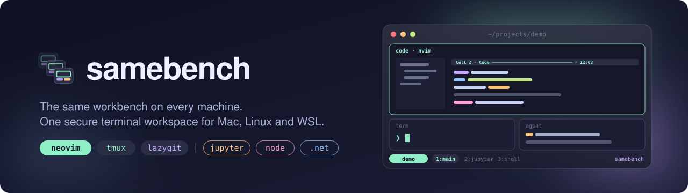

<div align="center">

<picture>
  <source media="(prefers-color-scheme: dark)" srcset="docs/assets/banner-dark.svg">
  <source media="(prefers-color-scheme: light)" srcset="docs/assets/banner-light.svg">
  
</picture>

</div>

<br>

Samebench turns a Mac, a Linux machine or a WSL install into the same terminal workspace. You get Neovim with
LazyVim, tmux, lazygit and an AI coding agent side by side, plus Jupyter notebooks that share a kernel between your
editor and the browser. Two optional modules add what a full-stack project needs. One brings Node.js and the
language servers for TypeScript and Angular frontends, the other C# editing for .NET backends. Everything it
installs comes from a pinned list and waits for your yes.

<p align="center">
  
</p>

<table>
<tr>
<td width="50%" valign="top">

### Secure by default

Every tool, plugin, language server and Jupyter package is pinned in a lockfile, and nothing installs before you
say yes. New versions have to be at least seven days old, and a daily check tells you about known
vulnerabilities right when you start working.

</td>
<td width="50%" valign="top">

### One workbench, three systems

A Mac, a Linux VM over SSH and WSL on Windows all get the same editor, the same keys and the same look.
Profiles cover the small differences, so you never maintain three configs.

</td>
</tr>
<tr>
<td width="50%" valign="top">

### Notebooks with a shared kernel

`dev -j` runs the kernel inside the project's own `.venv`. Run a cell from Neovim and the variable is there in
JupyterLab too. The project you work in stays exactly as it is.

</td>
<td width="50%" valign="top">

### Plays well with what you have

Neovim, tmux and mise keep to their own folders and tmux runs its own server, so an existing setup keeps working.
`samebench plan` shows every change before it happens, and `samebench remove` undoes all of it.

</td>
</tr>
</table>

<br>

<div align="center">

**[Install](#install)** &nbsp;·&nbsp;
**[A day with it](#a-day-with-it)** &nbsp;·&nbsp;
**[Frontend and backend](#frontend-and-backend-side-by-side)** &nbsp;·&nbsp;
**[Notebooks](#notebooks)** &nbsp;·&nbsp;
**[Modules](#modules)** &nbsp;·&nbsp;
**[Security](#security-in-one-picture)** &nbsp;·&nbsp;
**[Commands](#commands)**

</div>

## Install

Three commands set up a machine. `samebench apply` checks the system, shows you a plan of everything it would
install and waits for your okay.

<details open>
<summary><b>macOS</b></summary>

<br>

```bash
xcode-select --install
git clone https://github.com/TechSiggi/samebench ~/Development/samebench
~/Development/samebench/bin/samebench apply mac
```

After your yes `samebench apply` downloads a single program itself, the version manager
[mise](https://mise.jdx.dev), and compares it with a SHA-256 sum pinned in `bin/samebench`. Everything else comes
through mise from the lockfiles.

</details>

<details>
<summary><b>Linux (Ubuntu or Debian, also a VM over SSH)</b></summary>

<br>

```bash
sudo apt-get update && sudo apt-get install -y git curl ca-certificates build-essential unattended-upgrades
git clone https://github.com/TechSiggi/samebench ~/samebench
~/samebench/bin/samebench apply linux
```

You don't need Python from apt. When a project needs Python, uv asks before it installs one.
`unattended-upgrades` keeps the system packages patched with the distribution's signed security updates. If you
connect over SSH, add the [port forwarding](docs/installation.md#linux-vm-over-ssh) to your local SSH config, so
that JupyterLab and your development servers open in your local browser.

</details>

<details>
<summary><b>WSL on Windows</b></summary>

<br>

Use the Linux steps inside your WSL distribution and keep the repository and your projects in the Linux file system
(`~/…`), not under `/mnt/c`. The [installation guide](docs/installation.md#wsl-on-windows) explains how to limit
what WSL processes can reach on the Windows side.

</details>

Two things are left after that, on every system. The icons need a Nerd Font in your terminal.
[Ghostty](https://ghostty.org) ships them already. Without such a font, put `ICONS="unicode"` into
`~/.config/samebench/local.sh` and run `samebench apply` again to get plain characters. Your coding agent is not
part of the setup either. For Claude Code, use the official installer from Anthropic, read the script first, and
turn on `/sandbox` once inside Claude. Then open a new terminal and type `dev` in any project folder.

> [!TIP]
> Already have Neovim, tmux, uv or Jupyter on that machine? They stay untouched. Run `bin/samebench plan mac` or
> `bin/samebench plan linux` first to see exactly what would change, and read
> [machines with an existing setup](docs/installation.md#machines-with-an-existing-setup).

## A day with it

```bash
cd ~/projects/demo
dev
```

`dev` opens the workspace for the folder you are in, with Neovim on top, a terminal at the bottom left and your
agent at the bottom right. Every workspace is a tmux session named after its folder, and it keeps running until
you stop it. Leave it at any time, and the next `dev` in that folder puts you back in front of the editor, the
agent and every running program, exactly as you left them. That also holds when an SSH connection drops.

| You want to | Do this |
|---|---|
| Move between the editor, the terminal and the agent | <kbd>Ctrl</kbd>+<kbd>h</kbd> <kbd>j</kbd> <kbd>k</kbd> <kbd>l</kbd> |
| Give one pane the whole screen, and take it back | <kbd>Ctrl</kbd>+<kbd>b</kbd> then <kbd>z</kbd> |
| Find a file, or open the file explorer | <kbd>Space</kbd> <kbd>Space</kbd>, or <kbd>Space</kbd> <kbd>e</kbd> |
| Commit and push with lazygit | <kbd>Space</kbd> <kbd>g</kbd> <kbd>g</kbd> in the editor, or <kbd>Ctrl</kbd>+<kbd>b</kbd> then <kbd>g</kbd> from any pane |
| Get a free shell | <kbd>Ctrl</kbd>+<kbd>b</kbd> then <kbd>2</kbd> opens the `shell` window, or <kbd>3</kbd> in a session with Jupyter. <kbd>Ctrl</kbd>+<kbd>b</kbd> then <kbd>1</kbd> goes back |
| Leave, and let everything keep running | <kbd>Ctrl</kbd>+<kbd>b</kbd> then <kbd>d</kbd> |
| Stop for today | `dev -k`, which doesn't ask, so save with `:wa` first |
| See every key at the point you are at | Press <kbd>Space</kbd> and wait a moment, or <kbd>Space</kbd> <kbd>H</kbd> for the short cheat sheet |

`dev -l agent` opens the other layout from the picture at the top, with the agent on the left and Neovim on the
right for reviewing. In a Python project the `.venv` of the folder is active in the whole session, so the editor,
the agent and the terminal all see its packages.

### Frontend and backend side by side

A full-stack project gets one session per repository, for example an Angular frontend in `shop-web` and a .NET
backend in `shop-api`. With the `web` and `dotnet` [modules](#modules) turned on, four steps bring both up.

| | Where you are | What you type |
|:---:|---|---|
| 1 | Your terminal | `dev ~/projects/shop-api` |
| 2 | The terminal pane of `shop-api` | `dev ~/projects/shop-web` |
| 3 | The terminal pane of `shop-web` | `npx ng serve` |
| 4 | Back in `shop-api` with <kbd>Ctrl</kbd>+<kbd>b</kbd> then <kbd>s</kbd>, in its terminal pane | `dotnet run` |

The second `dev` builds the frontend session and takes you straight into it, while the backend session stays
open behind it. From then on three keys are all you need.

<p align="center">
  
</p>

| Keys | What happens |
|---|---|
| <kbd>Ctrl</kbd>+<kbd>b</kbd> then <kbd>s</kbd> | Shows both sessions. Pick one with the arrow keys and <kbd>Enter</kbd> |
| <kbd>Ctrl</kbd>+<kbd>b</kbd> then <kbd>L</kbd> | Jumps straight back to the session you came from |
| <kbd>Ctrl</kbd>+<kbd>b</kbd> then <kbd>d</kbd> | Leaves tmux. Both sessions and both servers keep running, and `dev` in either folder takes you back |

Each session has its own editor, its own agent and its own server, so you never restart one to look at the other.
The servers keep the two terminal panes busy. For `npm ci`, `dotnet test` and everything else, use the `shell`
window of the session with <kbd>Ctrl</kbd>+<kbd>b</kbd> then <kbd>2</kbd>. <kbd>Ctrl</kbd>+<kbd>c</kbd> stops a
server, and `dev -k` stops the whole session of the folder you are in.

Three things are worth knowing.

- The first `dev` in each of the two folders asks whether you trust it, because the language servers load code
  from the project. Say yes for your own projects.
  [Opening someone else's repository](docs/updates-and-security.md#opening-someone-elses-repository) says what a
  yes allows.
- `dev` brings the language servers and never starts your application. It never installs a project's packages
  either, so `npm ci` and `dotnet restore` stay with you. Inside the editor, <kbd>Space</kbd> <kbd>D</kbd> opens
  the .NET keys to build, run and test.
- On a VM over SSH, [forward the ports](docs/installation.md#a-frontend-development-server-on-the-vm) of the two
  servers to open the application in your local browser.

### Notebooks

```bash
dev -j          # like dev, plus JupyterLab and a kernel for this project
jlab            # open JupyterLab in the browser, already logged in
```

Inside Neovim, <kbd>Space</kbd> <kbd>j</kbd> <kbd>k</kbd> turns the terminal below into a console attached to the
notebook's kernel, and <kbd>Space</kbd> <kbd>j</kbd> <kbd>j</kbd> runs the current cell. Open the same notebook in
the browser and every variable is already there.

<p align="center">
  
</p>

The kernel runs from the project's own `.venv`. `dev -j` builds it with `uv sync --frozen`, exactly as the
project's `uv.lock` says, and asks you once before it installs those packages. The
[notebook guide](docs/notebooks.md) covers the questions `dev -j` asks, the cell keys and working in the browser.

## Modules

Neovim, tmux, lazygit and the agent are the same on every machine. Support for a language comes as a module, and
each machine only gets the modules you list for it.

| Module | For | What you get | Turned on |
|---|---|---|---|
| `core` | Every project | Neovim with LazyVim, tmux, lazygit and the pane for your agent | On every machine |
| `python` | Python and Jupyter notebooks | uv, ruff and ty, and `dev -j` with a kernel shared between editor and browser | In both profiles |
| [`web`](docs/configuration.md#the-web-module) | TypeScript and Angular | Node.js and the language servers for TypeScript, Angular, HTML, SCSS and ESLint | When you add it |
| [`dotnet`](docs/configuration.md#the-dotnet-module) | C# and .NET | C# editing with the Roslyn language server and keys to build, run and test. The .NET SDK comes from your system | When you add it |

To add a module, list it in `local.sh` and run `samebench apply` again. It shows what the module would install
and waits for your yes. You create that file yourself, and
[settings for one machine only](docs/configuration.md#settings-for-one-machine-only) shows how, also before the
first setup.

```bash
# ~/.config/samebench/local.sh
MODULES="core python web dotnet"
```

A module brings the runtime and the editing support, and never a project's own dependencies. Angular and its
CLI come from each project's `package.json`, and NuGet packages from the project as well.

Your daily commands stay the same with every module. A plain `dev` in an Angular or a .NET project starts the
right language servers, and the first time it asks whether you trust the folder.

## Security in one picture

<p align="center">
  
</p>

The tools, plugins, language servers and packages this setup installs come from pinned lists, and every install
waits for your yes. `samebench apply` shows its plan first, and `dev -j` asks before it installs the Jupyter tool,
a project's packages or a Python version. Nothing installs itself in the background. Mason, the prebuilt
completion binary, tmux plugins and every `curl | sh` installer are switched off on purpose.

Two things in the picture are not pinned lists. The .NET SDK of the `dotnet` module comes from your system, as a
signed package of the distribution or as Microsoft's signed installer, and `samebench apply` asks before apt
installs it. And with the `web` and `dotnet` modules, the editor only loads code from a project after you have
told `dev` that you trust the folder. That covers a project's own TypeScript, ESLint and prettier, and the C#
language server, which runs build targets from the project.

The lists change on one machine, in one commit you can read, and an update only takes versions that are at least
seven days old. If you sign your commits, `samebench sync` refuses anything you did not sign. A repository you
clone can't run code just because you [open it](docs/updates-and-security.md#opening-someone-elses-repository).

> [!IMPORTANT]
> The coding agent runs commands with your permissions, which makes it the biggest risk in any setup like this.
> Keep its sandbox on, never forward your SSH agent to a VM, and give a VM access only to the repositories it needs.

The full story is in [updates and security](docs/updates-and-security.md).

## Commands

| Command | What it does |
|---|---|
| `dev` · `dev ~/projects/demo` | Start or reopen the workspace for the current folder · for another folder |
| `dev -j` · `dev -l agent` | Add Jupyter · put the agent on the left |
| `dev -s` · `dev -k` · `dev -r` | List sessions · stop this one · rebuild it, for example `dev -r -j` to add Jupyter |
| `jlab` | Open the running JupyterLab |
| `samebench plan` · `samebench apply` | Show what would change · set everything up |
| `samebench update` · `samebench sync` | Monthly update on one machine · bring the others up to date |
| `samebench check` · `samebench fix` | Look for vulnerabilities · lift one package to its fixed version |
| `samebench doctor` · `samebench remove` | Check the state of this machine · undo everything |
| `samebench mise ls` · `samebench remove --all` | Ask the mise of samebench · also delete its programs and data |

`dev` runs on its own tmux server, so a plain `tmux ls` doesn't list these sessions. `dev -s` does, and inside a
session <kbd>Ctrl</kbd>+<kbd>b</kbd> then <kbd>s</kbd> shows the same list. Every key for Neovim, tmux, lazygit,
notebooks and .NET is on the [cheat sheet](docs/cheatsheet.md).

## What works where

|  | macOS | Linux desktop | WSL | Linux over SSH |
|---|:---:|:---:|:---:|:---:|
| Layouts, Neovim, lazygit, agent | ✅ | ✅ | ✅ | ✅ |
| `dev -j` with a shared Jupyter kernel | ✅ | ✅ | ✅ | ✅ |
| `jlab` opens your browser | ✅ | ✅ | ✅ | prints a clickable link |
| Python installed by uv when needed | ✅ | ✅ | ✅ | ✅ |
| TypeScript and Angular editing with the [`web` module](docs/configuration.md#the-web-module) | ✅ | not tested yet | not tested yet | not tested yet |
| C# editing with the [`dotnet` module](docs/configuration.md#the-dotnet-module) | ✅ | not tested yet | not tested yet | not tested yet |
| Nerd Font for the icons, set in | your terminal | your terminal | Windows Terminal | your local terminal |

The full setup, both modules included, has been tested on macOS. Linux and WSL have not had a complete run yet,
so expect rough edges there and please report them. The step that offers the .NET SDK through apt has only been
run against stand-ins, not on a real Ubuntu or Debian.

## When you need more

Everything for a normal day is on this page. These guides are for the moments that go beyond it.

| Guide | Read it when |
|---|---|
| [Installation](docs/installation.md) | You set up a VM over SSH or WSL, need the .NET SDK, sit behind a proxy, or want everything removed again |
| [Notebooks](docs/notebooks.md) | You work with Jupyter notebooks |
| [Updates and security](docs/updates-and-security.md) | It's update day, a security warning showed up, or you open a repository you don't know |
| [Configuration](docs/configuration.md) | You want to change a profile or the look, or turn on the `web` or `dotnet` module |
| [How it works](docs/architecture.md) | You want to understand or change the scripts |
| [Cheat sheet](docs/cheatsheet.md) | You forgot a key |

<br>

<div align="center">
<sub>Built on <a href="https://www.lazyvim.org">LazyVim</a>, <a href="https://github.com/tmux/tmux">tmux</a>,
<a href="https://github.com/jesseduffield/lazygit">lazygit</a>, <a href="https://mise.jdx.dev">mise</a> and
<a href="https://docs.astral.sh/uv">uv</a>. Released under the <a href="LICENSE">MIT license</a>.</sub>
</div>
