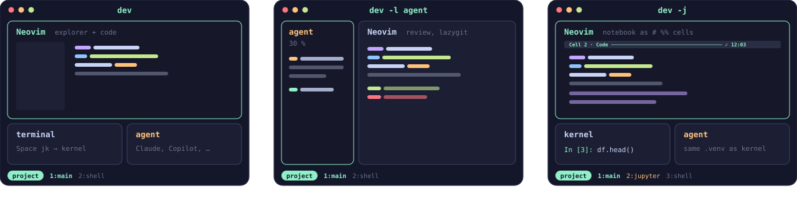

<div align="center">

<picture>
  <source media="(prefers-color-scheme: dark)" srcset="docs/assets/banner-dark.svg">
  <source media="(prefers-color-scheme: light)" srcset="docs/assets/banner-light.svg">
  
</picture>

<br>

**[Install](docs/installation.md)** &nbsp;·&nbsp;
**[Daily use](docs/daily-use.md)** &nbsp;·&nbsp;
**[Notebooks](docs/notebooks.md)** &nbsp;·&nbsp;
**[Security](docs/updates-and-security.md)** &nbsp;·&nbsp;
**[Cheat sheet](docs/cheatsheet.md)**

</div>

<br>

Samebench turns a Mac, a Linux machine or a WSL install into the same terminal workspace. You get Neovim with
LazyVim, tmux, lazygit and an AI coding agent side by side, plus Jupyter notebooks that share a kernel between your
editor and the browser. Everything it installs comes from a pinned list and waits for your yes.

<p align="center">
  
</p>

<table>
<tr>
<td width="50%" valign="top">

### Secure by default

Every tool, plugin and Jupyter package is pinned in a lockfile, and nothing installs before you say yes. New
versions have to be at least seven days old, and a daily check tells you about known vulnerabilities right when
you start working.

</td>
<td width="50%" valign="top">

### One workbench, three systems

A Mac, a Linux VM over SSH and WSL on Windows all get the same editor, the same keys and the same look.
Profiles cover the small differences, so you never maintain three configs.

</td>
</tr>
<tr>
<td width="50%" valign="top">

### Notebooks with a shared kernel

`dev -j` runs the kernel inside the project's own `.venv`. Run a cell from Neovim and the variable is there in
JupyterLab too. The project you work in stays exactly as it is.

</td>
<td width="50%" valign="top">

### Plays well with what you have

Neovim and tmux run in their own folders and their own server, so an existing setup keeps working.
`samebench plan` shows every change before it happens, and `samebench remove` undoes all of it.

</td>
</tr>
</table>

## Quick start

<details open>
<summary><b>macOS</b></summary>

<br>

```bash
xcode-select --install
git clone https://github.com/TechSiggi/samebench ~/Development/samebench
~/Development/samebench/bin/samebench apply mac
```

`samebench apply` checks the system, shows you a plan of everything it would install and waits for your okay. After
your yes it downloads a single program itself, the version manager [mise](https://mise.jdx.dev), and compares it
with a SHA-256 sum pinned in `bin/samebench`. Everything else comes through mise from the lockfiles. Open a new
terminal afterwards and type `dev` in any project folder.

</details>

<details>
<summary><b>Linux (Ubuntu or Debian, also a VM over SSH)</b></summary>

<br>

```bash
sudo apt-get update && sudo apt-get install -y git curl ca-certificates build-essential unattended-upgrades
git clone https://github.com/TechSiggi/samebench ~/samebench
~/samebench/bin/samebench apply linux
```

You don't need Python from apt. When a project needs Python, uv asks before it installs one. If you connect over
SSH, add the [port forwarding for JupyterLab](docs/installation.md#linux-vm-over-ssh) to your local SSH config.

</details>

<details>
<summary><b>WSL on Windows</b></summary>

<br>

Use the Linux steps inside your WSL distribution and keep the repository and your projects in the Linux file system
(`~/…`), not under `/mnt/c`. Set a Nerd Font in Windows Terminal, or put `ICONS="unicode"` into
`~/.config/samebench/local.sh`. The [installation guide](docs/installation.md#wsl-on-windows) explains how to limit
what WSL processes can reach on the Windows side.

</details>

> [!TIP]
> Already have Neovim, tmux, uv or Jupyter on that machine? They stay untouched. Run `bin/samebench plan mac` or
> `bin/samebench plan linux` first to see exactly what would change, and read
> [machines with an existing setup](docs/installation.md#machines-with-an-existing-setup).

## What works where

|  | macOS | Linux desktop | WSL | Linux over SSH |
|---|:---:|:---:|:---:|:---:|
| Layouts, Neovim, lazygit, agent | ✅ | ✅ | ✅ | ✅ |
| `dev -j` with a shared Jupyter kernel | ✅ | ✅ | ✅ | ✅ |
| `jlab` opens your browser | ✅ | ✅ | ✅ | prints a clickable link |
| Python installed by uv when needed | ✅ | ✅ | ✅ | ✅ |
| Nerd Font for the icons, set in | your terminal | your terminal | Windows Terminal | your local terminal |

## A day with it

```bash
cd ~/projects/demo
dev -j          # editor, terminal and agent, plus Jupyter for this project
jlab            # open JupyterLab, already logged in
dev -k          # done for today, stop everything in this session
```

Inside Neovim, <kbd>Space</kbd> <kbd>j</kbd> <kbd>k</kbd> turns the terminal below into a console attached to the
notebook's kernel, and <kbd>Space</kbd> <kbd>j</kbd> <kbd>j</kbd> runs the current cell. Open the same notebook in
the browser and every variable is already there.

<p align="center">
  
</p>

The kernel runs from the project's own `.venv`. `dev -j` builds it with `uv sync --frozen`, exactly as the
project's `uv.lock` says, and asks you once before it installs those packages.

There is a lot more to it, from the three layouts to the notebook cell bars. The [daily use guide](docs/daily-use.md)
and the [notebook guide](docs/notebooks.md) walk through all of it.

## Security in one picture

<p align="center">
  
</p>

The tools, plugins and packages this setup installs come from pinned lists, and every install waits for your yes.
`samebench apply` shows its plan first, and `dev -j` asks before it installs the Jupyter tool, a project's packages
or a Python version. Nothing installs itself in the background. Mason, the prebuilt completion binary, tmux plugins
and every `curl | sh` installer are switched off on purpose.

The lists change on one machine, in one commit you can read, and an update only takes versions that are at least
seven days old. If you sign your commits, `samebench sync` refuses anything you did not sign. A repository you
clone can't run code just because you [open it](docs/updates-and-security.md#opening-someone-elses-repository).

> [!IMPORTANT]
> The coding agent runs commands with your permissions, which makes it the biggest risk in any setup like this.
> Keep its sandbox on, never forward your SSH agent to a VM, and give a VM access only to the repositories it needs.

The full story is in [updates and security](docs/updates-and-security.md).

## Commands

| Command | What it does |
|---|---|
| `dev` | Start or reopen the workspace for the current folder |
| `dev -j` · `dev -l agent` | Add Jupyter · put the agent on the left |
| `dev -s` · `dev -k` · `dev -r` | List sessions · stop this one · rebuild it |
| `jlab` | Open the running JupyterLab |
| `samebench plan` · `samebench apply` | Show what would change · set everything up |
| `samebench update` · `samebench sync` | Monthly update on one machine · bring the others up to date |
| `samebench check` · `samebench fix` | Look for vulnerabilities · lift one package to its fixed version |
| `samebench doctor` · `samebench remove` | Check the state of this machine · undo everything |

<details>
<summary><b>Keys you will use every day</b></summary>

<br>

| Keys | Action |
|---|---|
| <kbd>Space</kbd> | Wait a moment and which-key shows everything |
| <kbd>Space</kbd> <kbd>Space</kbd> | Find a file |
| <kbd>Space</kbd> <kbd>e</kbd> | Toggle the file explorer |
| <kbd>Space</kbd> <kbd>g</kbd> <kbd>g</kbd> | lazygit |
| <kbd>Ctrl</kbd>+<kbd>h</kbd> <kbd>j</kbd> <kbd>k</kbd> <kbd>l</kbd> | Move between Neovim windows and tmux panes |
| <kbd>Ctrl</kbd>+<kbd>b</kbd> then <kbd>z</kbd> | Zoom the current pane |
| <kbd>Ctrl</kbd>+<kbd>b</kbd> then <kbd>d</kbd> | Leave the session, it keeps running |
| <kbd>Space</kbd> <kbd>H</kbd> | Open the short cheat sheet inside Neovim |

The [full cheat sheet](docs/cheatsheet.md) covers Neovim, tmux, lazygit and notebooks.

</details>

## Documentation

| Guide | Read it when |
|---|---|
| [Installation](docs/installation.md) | You set up a new machine, a VM over SSH or WSL |
| [Daily use](docs/daily-use.md) | You want to know the layouts, sessions and `jlab` |
| [Notebooks](docs/notebooks.md) | You work with Jupyter notebooks |
| [Updates and security](docs/updates-and-security.md) | It's update day, or a security warning showed up |
| [Configuration](docs/configuration.md) | You want to change a profile, the look or add a module |
| [How it works](docs/architecture.md) | You want to understand or change the scripts |
| [Cheat sheet](docs/cheatsheet.md) | You forgot a key |

The [documentation index](docs/README.md) lists the same guides and says what has been tested on which system.

<br>

<div align="center">
<sub>Built on <a href="https://www.lazyvim.org">LazyVim</a>, <a href="https://github.com/tmux/tmux">tmux</a>,
<a href="https://github.com/jesseduffield/lazygit">lazygit</a>, <a href="https://mise.jdx.dev">mise</a> and
<a href="https://docs.astral.sh/uv">uv</a>. Released under the <a href="LICENSE">MIT license</a>.</sub>
</div>
