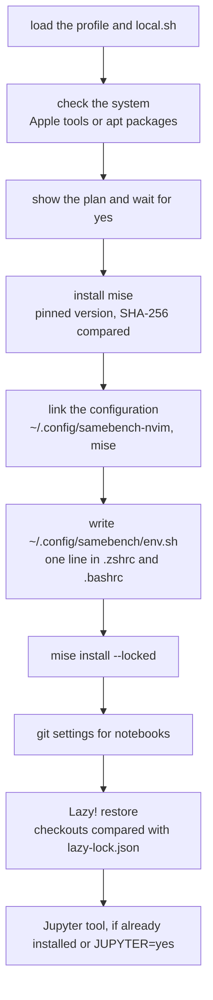

# How it works

[← Back to the overview](../README.md)

This page is for the moment you want to change something in the scripts themselves. It walks through the pieces,
then through the few places where the scripts do something that is not obvious from reading them once.

## The pieces

```text
bin/samebench                plan · apply · update · sync · check · fix · doctor · jupyter · remove
bin/dev                      starts the tmux layouts, -j adds Jupyter
bin/jlab                     prints a clickable link to JupyterLab and opens the browser where it can
libexec/common.sh            output and question helpers shared by samebench and dev
libexec/jupyter-attach       connects the console to a notebook's kernel, standard library only
libexec/nb-convert           turns a notebook into Python cells and back, for Neovim and git
libexec/ipynb-textconv       notebook diffs for git, falls back to the plain file without Jupyter
libexec/samebench-check.lua  vulnerability check against OSV.dev, runs with nvim -l and needs only curl
libexec/lock-plugins.lua     holds the Neovim plugins to the seven day rule on update day
profiles/                    mac.sh, linux.sh
modules/<module>/tools.toml  tools per module, installed by mise
config/mise-global/          mise settings and mise.lock
config/nvim/                 the LazyVim configuration and lazy-lock.json
config/tmux/                 tmux.conf without plugins for the dev server, nerd.conf for round pills
config/lazygit/              lazygit colours
config/jupyter/              console colours
envs/jupyter/                the Jupyter tool, pyproject.toml and uv.lock
docs/                        this documentation
```

The three commands are plain Bash that also runs on the old Bash 3.2 of macOS. The helpers in `libexec/` are a
few short shell, Python and Lua files. There is no framework and no build step.

## What `samebench apply` does



Nothing before the question changes the machine, apart from apt packages that `samebench` found missing and asked about
separately. `samebench apply -y` skips the question, which is how `samebench sync` calls it after asking its own.

The mise step does nothing when exactly the pinned version already sits in `~/.local/bin`. Otherwise it downloads
the release archive over HTTPS into a temporary folder, compares its SHA-256 with the sum for this platform from
the top of `bin/samebench`, and only then copies the binary into place. A mismatch ends `samebench` with nothing installed. A
mise that was there before `samebench` ever set up this machine is moved to `mise.backup-<date>` first, and `samebench remove`
puts it back when you let it delete the installed programs as well.

On a new machine the Neovim configuration fetches lazy.nvim and LazyVim itself first, each at its locked commit,
before lazy.nvim starts. LazyVim names most of the plugins. Without it lazy.nvim would install in two rounds, forget
the locked commits of the second round and install those plugins at their newest commit. With LazyVim in place one
round installs every plugin at its locked commit.

The plugin step has a safeguard of its own on top of that. lazy.nvim writes `lazy-lock.json` again after every
install, from the plugins it finds installed. A run that fails halfway would drop pins that way, and the next run would fetch the
newest commits instead. `samebench apply` therefore keeps the pinned list aside before it starts Neovim and puts it
back when lazy.nvim changed it. At the end it compares the checkout of every plugin with its locked commit and
stops when one is missing or differs.

`env.sh` has two parts. The first part always runs and only makes `samebench`, `dev`, `jlab` and mise reachable on the
`PATH`. The second part activates mise, sets the editor and handles the project's `.venv`. With `ACTIVATE="dev"`
that second part only runs inside `dev` sessions, which is how other shells stay untouched.

## Where things live on a machine

| Path | Content |
|---|---|
| `~/.config/samebench/` | profile name, `env.sh`, generated git and tmux snippets, `local.sh`, `allowed_signers` |
| `~/.config/samebench-nvim` | link to `config/nvim` in this repository |
| `~/.local/bin/mise` | the pinned mise |
| `~/.local/share/samebench-nvim/` | Neovim plugins and parsers |
| `~/.local/share/samebench/` | the Jupyter tool, kernel definitions per project, kernel overlays, approved project lockfiles |
| `~/.local/share/mise/` | the tools from mise |
| `~/.local/state/mise/`, `~/.cache/mise/`, on macOS also `~/Library/Caches/mise/` | state and cached downloads of mise |
| `~/.cache/samebench/` | the result of the daily check |

Neovim runs with `NVIM_APPNAME=samebench-nvim`, which gives it its own configuration, data and cache folders. tmux runs as
`tmux -L samebench -f config/tmux/tmux.conf`, a separate server that never reads `~/.tmux.conf`.

## The kernel trick behind `dev -j`

Jupyter looks for kernel definitions in the folders listed in `JUPYTER_PATH` before its built in ones. `samebench kernel`
writes a definition named `python3` whose command is the Python of the project's `.venv`, in a folder that belongs
to that project, and `dev` sets `JUPYTER_PATH` for the session. JupyterLab, the console and `Space j k` therefore
all start the same kernel without anyone touching the project. A project without a `.venv` gets the same
definition with the Python of the Jupyter tool.

The definition does not start the kernel with the usual `python -m ipykernel_launcher`. That form searches the
kernel's working folder first, which is the folder of the notebook, so an `ipykernel_launcher.py` lying there would
run as soon as the notebook is opened. The command takes the working folder off the import path before it loads
the kernel. IPython puts it back once the kernel is up, so a notebook still imports the modules next to it.

When the project has no `ipykernel`, `samebench` exports `ipykernel` and its dependencies with hashes from
`envs/jupyter/uv.lock`, installs them with `uv pip install` into a small overlay environment built on the project's
Python, and adds that overlay to the kernel's `PYTHONPATH`. `uv pip install --require-hashes` refuses every package
without a matching hash. `uv run --with` was tested as well and does not check them, which is why it isn't used.

Before `dev -j` runs `uv sync --frozen` in a project, it takes the SHA-256 of the project's `uv.lock` and looks it
up in `~/.local/share/samebench/approved-locks`. A hash that is not in that file leads to the question, and a yes appends
it. The summary shown with the question is read from the lockfile itself. That file belongs to the repository you
opened, so only its printable ASCII characters reach your terminal.

## Converting notebooks

Neovim and git never call the `jupytext` command. That command searches the notebook's folder for a configuration
file and runs a `.jupytext.py` it finds there as Python, which would let a repository execute code as soon as you
open or diff one of its notebooks. `libexec/nb-convert` calls the jupytext library instead, which reads no
configuration, and it runs with the Python of the Jupyter tool in isolated mode (`-I`). The result is the same text
the command produces, and writing back keeps the outputs of the existing notebook.

## The seven day rule for plugins

mise and uv know when a release was published and enforce the minimum age themselves. Plugins come straight from
git, so `samebench update` does that part in three steps. `Lazy! check` fetches every plugin, `libexec/lock-plugins.lua`
rewrites `lazy-lock.json`, and `Lazy! restore` checks out exactly what the lockfile now says. The three steps run
twice, so that plugins a new LazyVim version brought along are covered too.

lazy.nvim writes the lockfile once more after that checkout, which is how plugins that LazyVim added or dropped get
in and out of the list. A checkout that fails must not take a chosen commit along on that way. So after every
round `samebench update` compares the list with the one the script wrote. When a commit changed, or a plugin left the
list although it is not installed, the chosen list is put back and the update stops. At the end every checkout has
to match its entry.

For a plugin that follows a branch, the script picks the newest commit on the first parent line of that branch
that is at least seven days old. For a plugin that its spec pins to a version, a tag or a commit, it takes the
commit lazy.nvim itself would choose, but only once that commit is seven days old. A plugin never moves backwards
from a commit that is old enough, and a plugin that is not installed keeps its entry. A locked commit that is
itself younger than seven days moves back to the commit the script picks. That covers a plugin which a new LazyVim
version brought along and which lazy.nvim installed at its newest commit. Any error ends Neovim with exit code 1,
which stops `samebench update` before the lockfile is written.

## The daily check

`samebench daily` runs at most once a day from `dev`. It calls `libexec/samebench-check.lua` with `nvim -l`, which reads the
versions from `mise.lock`, the installed Jupyter packages and the PyPI packages of the project's `uv.lock`, sends
them to OSV.dev in a single batch request, and fetches the details of every finding in parallel. Severity comes
from the GitHub advisory database. The result is written to `~/.cache/samebench/check.txt`, one finding per line. When
any answer is missing or broken, the script exits with status 2 and leaves the previous result alone.

`samebench fix` lifts a tool with `mise lock <tool>@<version>` and a Jupyter package with
`uv lock --upgrade-package <name>==<version> --exclude-newer-package <name>=false`. Both keep checksums and hashes
mandatory.

## Syncing safely

`samebench sync` fetches, lists the incoming commits, verifies their SSH signatures against
`~/.config/samebench/allowed_signers` when that file exists, and asks before it merges. Local security patches are put
aside with `git stash`, and the stash is dropped once the repository contains the same or a newer version.
Otherwise the patches are applied again. The final `samebench apply` is started as a new process, so the scripts that
were just fetched do the work, and a mise version they pin is installed on the way.
