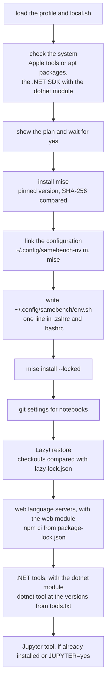

<div align="center">

<picture>
  <source media="(prefers-color-scheme: dark)" srcset="assets/head-architecture-dark.svg">
  <source media="(prefers-color-scheme: light)" srcset="assets/head-architecture-light.svg">
  
</picture>

<br>

**[The pieces](#the-pieces)** &nbsp;·&nbsp;
**[samebench apply](#what-samebench-apply-does)** &nbsp;·&nbsp;
**[Where things live](#where-things-live-on-a-machine)** &nbsp;·&nbsp;
**[Project code](#how-dev-decides-about-project-code)** &nbsp;·&nbsp;
**[Kernel](#the-kernel-trick-behind-dev--j)** &nbsp;·&nbsp;
**[Seven day rule](#the-seven-day-rule)** &nbsp;·&nbsp;
**[Daily check](#the-daily-check)** &nbsp;·&nbsp;
**[Sync](#syncing-safely)**

[← Back to the overview](../README.md)

</div>

<br>

This page is for the moment you want to change something in the scripts themselves. It walks through the pieces,
then through the few places where the scripts do something that is not obvious from reading them once.

## The pieces

```text
bin/samebench                plan · apply · update · sync · check · fix · doctor · jupyter · remove
bin/dev                      starts the tmux layouts, -j adds Jupyter
bin/jlab                     prints a clickable link to JupyterLab and opens the browser where it can
libexec/common.sh            output and question helpers shared by samebench and dev
libexec/jupyter-attach       connects the console to a notebook's kernel, standard library only
libexec/nb-convert           turns a notebook into Python cells and back, for Neovim and git
libexec/ipynb-textconv       notebook diffs for git, falls back to the plain file without Jupyter
libexec/samebench-check.lua  vulnerability check against OSV.dev, runs with nvim -l and needs only curl
libexec/lock-plugins.lua     holds the Neovim plugins to the seven day rule on update day
libexec/dotnet-tool-news.lua shows on update day what the NuGet feed has for the pinned .NET tools
libexec/tmux-status          CPU, memory and free disk for the tmux status bar, from system counters only
profiles/                    mac.sh, linux.sh
modules/<module>/tools.toml  tools per module, installed by mise
config/mise-global/          mise settings and mise.lock
config/nvim/                 the LazyVim configuration and lazy-lock.json
config/tmux/                 tmux.conf without plugins for the dev server, nerd.conf for round pills
config/lazygit/              lazygit colours
config/jupyter/              console colours
envs/jupyter/                the Jupyter tool, pyproject.toml and uv.lock
envs/web/                    the web language servers, package.json and package-lock.json
envs/dotnet/                 the two .NET tools of the dotnet module, tools.txt with exact versions
docs/                        this documentation
```

The three commands are plain Bash that also runs on the old Bash 3.2 of macOS. The helpers in `libexec/` are a
few short shell, Python and Lua files. There is no framework and no build step.

## What `samebench apply` does



Nothing before the question changes the machine, apart from apt packages that `samebench` found missing and asked about
separately. `samebench apply -y` skips the question, which is how `samebench sync` calls it after asking its own.

The mise step does nothing when exactly the pinned version already sits in `~/.local/bin`. Otherwise it downloads
the release archive over HTTPS into a temporary folder, compares its SHA-256 with the sum for this platform from
the top of `bin/samebench`, and only then copies the binary into place. A mismatch ends `samebench` with nothing installed. A
mise that was there before `samebench` ever set up this machine is moved to `mise.backup-<date>` first, and `samebench remove`
puts it back when you let it delete the installed programs as well. In that case the data and cache folders of mise
stay, since the earlier mise keeps its tools in the same place.

On a new machine the Neovim configuration fetches lazy.nvim and LazyVim itself first, each at its locked commit,
before lazy.nvim starts. LazyVim names most of the plugins. Without it lazy.nvim would install in two rounds, forget
the locked commits of the second round and install those plugins at their newest commit. With LazyVim in place one
round installs every plugin at its locked commit.

The plugin step has a safeguard of its own on top of that. lazy.nvim writes `lazy-lock.json` again after every
install, from the plugins it finds installed. A run that fails halfway would drop pins that way, and the next run would fetch the
newest commits instead. `samebench apply` therefore keeps the pinned list aside before it starts Neovim and puts it
back when lazy.nvim changed it. At the end it compares the checkout of every plugin with its locked commit and
stops when one is missing or differs.

`lazy-lock.json` is one list for all machines, and it holds a plugin that only the `dotnet` module uses,
easy-dotnet.nvim. lazy.nvim drops a plugin it does not know from the list whenever it writes the file, so a
machine without that module would lose the pin and fail the comparison at the end. That is why
`config/nvim/lua/plugins/modules.lua` names the plugin for every machine, without anything that loads it. It is
checked out everywhere at its locked commit and stays on disk, unloaded. The file types, commands and keys that
load it are in `lua/modules/dotnet.lua`, which is only part of the configuration with the `dotnet` module.

With the `web` module, the language servers come next. npm would install into the folder that holds
`package.json`, which is the repository. So `samebench apply` copies `package.json` and `package-lock.json` from
`envs/web` into `~/.local/share/samebench/web-lsp` and runs `npm ci` there. `npm ci` installs exactly what the
lockfile says, compares every package with its integrity hash and, with `--ignore-scripts`, runs no install
script. samebench passes no registry, so npm uses the one from your own configuration. After an install that went
through, a copy of the lockfile is stored next to it, and the next `samebench apply` skips the step while that copy
and the repository's lockfile are the same. Neovim finds the folder through `SAMEBENCH_WEB_LSP` in `env.sh` and
starts every server by its full path.

With the `dotnet` module, the check of the system also compares `DOTNET_SDK` with `dotnet --list-sdks`. On Linux
it offers the missing package through apt when `apt-cache policy` shows a candidate, and otherwise it only says
where the version would come from. The two .NET tools follow after the web language servers. For each line of
`envs/dotnet/tools.txt`, `samebench apply` runs `dotnet tool update --tool-path ~/.local/share/samebench/dotnet-tools
<id> --version <version> --allow-downgrade`, which installs a missing tool and moves an existing one up or down
to exactly that version. dotnet keeps each tool in `.store/<id>/<version>` below that folder, and a tool that
already sits at its pinned version, and at no other, is skipped. The command runs in the home folder, because
NuGet reads its configuration from the current folder upwards and a project folder could bring a feed of its
own. The first `dotnet` command on a machine also creates the ASP.NET
development certificate, and `samebench` switches that off for its own calls, so the certificate is created by
the first `dotnet` command you run yourself. The package id
and the version only reach the command line when they consist of the characters such names are made of. Without
an SDK of version 10 or newer the step is left out with a warning.

Neovim finds the folder through `SAMEBENCH_DOTNET_TOOLS` and puts it on its own `PATH`, so no shell sees these
tools. `config/nvim/lua/modules/dotnet.lua` registers the keys, commands and file types that load easy-dotnet.nvim
only when the folder is trusted and both tools are in place. That second condition matters, because a plugin
that loads without its server would install one. For the same reason the module writes the small file in which
the plugin notes that its server is installed, before the plugin loads, so the plugin never runs its own check.

`env.sh` has two parts. The first part always runs and only makes `samebench`, `dev`, `jlab` and mise reachable on the
`PATH`. The second part activates mise, sets the editor and handles the project's `.venv`. With `ACTIVATE="dev"`
that second part only runs inside `dev` sessions, which is how other shells stay untouched.

## Where things live on a machine

| Path | Content |
|---|---|
| `~/.config/samebench/` | profile name, `env.sh`, generated git and tmux snippets, `local.sh`, `allowed_signers`, `trusted` with the project folders you trusted |
| `~/.config/samebench-nvim` | link to `config/nvim` in this repository |
| `~/.local/bin/mise` | the pinned mise |
| `~/.local/share/samebench-nvim/` | Neovim plugins and parsers |
| `~/.local/share/samebench/` | the Jupyter tool, kernel definitions per project, kernel overlays, approved project lockfiles, the web language servers, the .NET tools |
| `~/.local/share/mise/` | the tools from mise |
| `~/.local/state/mise/`, `~/.cache/mise/`, on macOS also `~/Library/Caches/mise/` | state and cached downloads of mise |
| `~/.cache/samebench/` | the result of the daily check |
| `~/.dotnet/`, `~/.nuget/`, on macOS also folders below `~/Library/Application Support/` | with the `dotnet` module, what .NET and its language servers keep for themselves, such as the NuGet package cache, logs and caches. They are not part of this setup and stay when it is removed |

The settings folder is always `~/.config/samebench`, also when `XDG_CONFIG_HOME` points somewhere else, because
the line in `.zshrc` and `.bashrc` and the tmux configuration name that path. The links for mise and Neovim follow
`XDG_CONFIG_HOME`, as those programs do.

Neovim runs with `NVIM_APPNAME=samebench-nvim`, which gives it its own configuration, data and cache folders. tmux runs as
`tmux -L samebench -f config/tmux/tmux.conf`, a separate server that never reads `~/.tmux.conf`.

## How `dev` decides about project code

Some language servers and formatters can load code from the project they work on, and
[updates and security](updates-and-security.md#opening-someone-elses-repository) lists what that is for each
module. `config/nvim/lua/modules/web.lua` only allows it in a trusted folder and runs the servers in the
restricted mode everywhere else. `config/nvim/lua/modules/dotnet.lua` has no restricted mode to fall back on, so
it does not load the plugin at all without trust.

Both files ask `config/nvim/lua/samebench/trust.lua`, and the rule exists only there. Neovim counts as trusted
when `SAMEBENCH_TRUSTED` is `1` in its environment and it was started in the folder that `SAMEBENCH_TRUSTED_DIR`
names, or below it. The folders are compared as plain text, and Neovim resolves links in its own folder first,
as `dev` does. Every other value, and no value at all, means no.

`dev` sets that variable when it builds a new session, never when it reopens a running one. A folder counts as
trusted when it, or a folder above it, is a line in `~/.config/samebench/trusted`. The lines are compared as plain
text. Otherwise `dev` looks for the files that mark a project of an active module. For `web` those are
`package.json`, `angular.json`, `nx.json` and `tsconfig.json`, for `dotnet` a `*.sln`, `*.slnx`, `*.csproj` or
`*.fsproj`. It looks at most three levels down and never inside `node_modules`, `.git`, `dist`, `bin` or `obj`.
When it finds one, it asks, and a yes appends the folder to the file. A folder with a line break in its name
can't be a line of that file, so `dev` says so and leaves it untrusted. It does the same in the home folder and
in `/`, where a yes would cover every project on the machine.
[Trusted project folders](configuration.md#trusted-project-folders) shows the question as you see it.

The session always gets explicit values. `SAMEBENCH_TRUSTED` is `1` or `0`, and `SAMEBENCH_TRUSTED_DIR` is the
line of the file that matched, or the folder you just said yes to, and empty otherwise. A tmux server keeps the
environment it was started with, and `dev` can be called from inside a trusted session, so an unset variable
would not be a safe way to say no. The folder is there because every shell of a session inherits its
environment. Without it, a Neovim started somewhere else from the terminal pane of a trusted session would be
trusted too. With `TRUST="all"`, `dev` skips the question and leaves the folder empty, which stands for every
folder, and `env.sh` exports the same two values, which also covers a Neovim started without `dev`.

## The kernel trick behind `dev -j`

Jupyter looks for kernel definitions in the folders listed in `JUPYTER_PATH` before its built in ones. `samebench kernel`
writes a definition named `python3` whose command is the Python of the project's `.venv`, in a folder that belongs
to that project, and `dev` sets `JUPYTER_PATH` for the session. JupyterLab, the console and `Space j k` therefore
all start the same kernel without anyone touching the project. A project without a `.venv` gets the same
definition with the Python of the Jupyter tool.

The definition does not start the kernel with the usual `python -m ipykernel_launcher`. That form searches the
kernel's working folder first, which is the folder of the notebook, so an `ipykernel_launcher.py` lying there would
run as soon as the notebook is opened. The command takes the working folder off the import path before it loads
the kernel. IPython puts it back once the kernel is up, so a notebook still imports the modules next to it.

When the project has no `ipykernel`, `samebench` exports `ipykernel` and its dependencies with hashes from
`envs/jupyter/uv.lock`, installs them with `uv pip install` into a small overlay environment built on the project's
Python, and adds that overlay to the kernel's `PYTHONPATH`. `uv pip install --require-hashes` refuses every package
without a matching hash. `uv run --with` was tested as well and does not check them, which is why it isn't used.

Before `dev -j` runs `uv sync --frozen` in a project, it takes the SHA-256 of the project's `uv.lock` and looks it
up in `~/.local/share/samebench/approved-locks`. A hash that is not in that file leads to the question, and a yes appends
it. The summary shown with the question is read from the lockfile itself. That file belongs to the repository you
opened, so only its printable ASCII characters reach your terminal.

## Converting notebooks

Neovim and git never call the `jupytext` command. That command searches the notebook's folder for a configuration
file and runs a `.jupytext.py` it finds there as Python, which would let a repository execute code as soon as you
open or diff one of its notebooks. `libexec/nb-convert` calls the jupytext library instead, which reads no
configuration, and it runs with the Python of the Jupyter tool in isolated mode (`-I`). The result is the same text
the command produces, and writing back keeps the outputs of the existing notebook.

## The seven day rule

mise and uv know when a release was published and enforce the minimum age themselves. npm gets the date from
`samebench update`, which passes the time of seven days ago as `--before`, so that npm only sees versions the
registry published before that moment, for the language servers and for everything they depend on.

The .NET tools have no lockfile that a program could move within a range, so update day only reports on them and
you keep to the rule by hand. `libexec/dotnet-tool-news.lua` asks `dotnet package search` for the versions, which
uses the feeds and the credentials of your NuGet configuration, and reads the publish dates from the
registration resource of the same feeds where a feed answers that without a login. It prints the pinned and the
newest version per feed and changes nothing.

Plugins come straight from git, so `samebench update` does that part in three steps. `Lazy! check` fetches every
plugin, `libexec/lock-plugins.lua` rewrites `lazy-lock.json`, and `Lazy! restore` checks out exactly what the
lockfile now says. The three steps run twice, so that plugins a new LazyVim version brought along are covered
too.

lazy.nvim writes the lockfile once more after that checkout, which is how plugins that LazyVim added or dropped get
in and out of the list. A checkout that fails must not take a chosen commit along on that way. So after every
round `samebench update` compares the list with the one the script wrote. When a commit changed, or a plugin left the
list although it is not installed, the chosen list is put back and the update stops. At the end every checkout has
to match its entry.

For a plugin that follows a branch, the script picks the newest commit on the first parent line of that branch
that is at least seven days old. For a plugin that its spec pins to a version, a tag or a commit, it takes the
commit lazy.nvim itself would choose, but only once that commit is seven days old. A plugin never moves backwards
from a commit that is old enough, and a plugin that is not installed keeps its entry. A locked commit that is
itself younger than seven days moves back to the commit the script picks. That covers a plugin which a new LazyVim
version brought along and which lazy.nvim installed at its newest commit. Any error ends Neovim with exit code 1,
which stops `samebench update` before the lockfile is written.

## The daily check

`samebench daily` runs at most once a day from `dev`. It calls `libexec/samebench-check.lua` with `nvim -l`, which reads the
versions from `mise.lock`, the installed Jupyter packages, the installed web language servers and the PyPI
packages of the project's `uv.lock`, sends them to OSV.dev in a single batch request, and fetches the details of
every finding in parallel. Severity comes from the GitHub advisory database, and for Node from the Bitnami
entries that the check uses because OSV has no package for Node itself. The two .NET tools are not part of the
check. The result is written to `~/.cache/samebench/check.txt`, one finding per line. When any answer is missing
or broken, the script exits with status 2 and leaves the previous result alone.

`samebench fix` lifts a tool with `mise lock <tool>@<version>` and a Jupyter package with
`uv lock --upgrade-package <name>==<version> --exclude-newer-package <name>=false`. Both keep checksums and hashes
mandatory. mise writes a tool of its core backend into `mise.lock` without quotes and without the backend, so
`"core:node"` in `tools.toml` is `[[tools.node]]` there, and the scripts read both spellings. A version outside the
major version pinned in `tools.toml` is refused, because a new major version is a change to `tools.toml` that you
make yourself. The web language servers have no targeted fix and move on update day. The version usually comes
from the advisory, so it only passes when it consists of letters, digits and the characters `.`, `+`, `_` and
`-`.

## Syncing safely

`samebench sync` fetches, lists the incoming commits, verifies their SSH signatures against
`~/.config/samebench/allowed_signers` when that file exists, and asks before it merges. Local security patches are put
aside with `git stash`, and the stash is dropped once the repository contains the same or a newer version.
Otherwise the patches are applied again. When they no longer fit the new lockfiles, `samebench sync` restores the
repository's state, drops the patches, names them and stops before anything is installed. The next check offers
the fixes again. The final `samebench apply` is started as a new process, so the scripts that
were just fetched do the work, and a mise version they pin is installed on the way.
