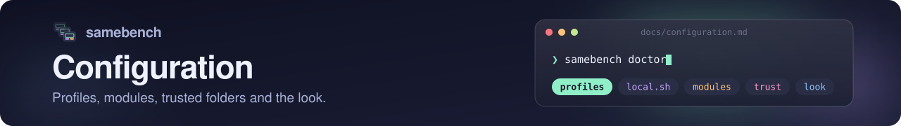
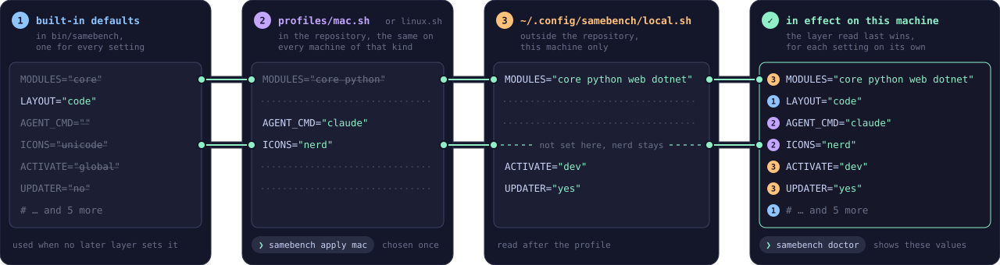

<div align="center">

<picture>
  <source media="(prefers-color-scheme: dark)" srcset="assets/head-configuration-dark.svg">
  <source media="(prefers-color-scheme: light)" srcset="assets/head-configuration-light.svg">
  
</picture>

<br>

**[Profiles](#profiles)** &nbsp;·&nbsp;
**[One machine only](#settings-for-one-machine-only)** &nbsp;·&nbsp;
**[Modules](#modules)** &nbsp;·&nbsp;
**[Trusted folders](#trusted-project-folders)** &nbsp;·&nbsp;
**[The look](#the-look)** &nbsp;·&nbsp;
**[Editor behaviour](#editor-behaviour-worth-knowing)**

[← Back to the overview](../README.md)

</div>

<br>

Settings live in three places. A profile describes a kind of machine, `local.sh` holds what concerns one machine
only, and the files under [`config/`](../config) define how the tools look and behave everywhere.

<p align="center">
  
</p>

## Profiles

A profile is a small shell file in [`profiles/`](../profiles). You choose it once with `samebench apply <profile>`, and
every later `samebench` command remembers it.

```bash
samebench apply mac      # or: samebench apply linux
```

Every setting has a built-in default, and a profile only lists what differs from it. Both profiles that ship
with the repository set the same three, `MODULES="core python"`, `AGENT_CMD="claude"` and `ICONS="nerd"`.

| Setting | Default | Values | Meaning |
|---|---|---|---|
| `MODULES` | `"core"` | names from `modules/` | Which modules are installed |
| `LAYOUT` | `code` | `code` · `agent` | The layout `dev` opens without `-l` |
| `AGENT_CMD` | empty | `claude`, `copilot`, `"claude --continue"`, … | The coding agent started in the layout, with arguments if you need them. Without one, that pane is a plain shell |
| `UV_PYTHON_DOWNLOADS` | `manual` | `manual` · `automatic` | `manual` means uv only installs Python after you confirm |
| `JUPYTER` | `ondemand` | `ondemand` · `yes` · `no` | Install the Jupyter tool on the first `dev -j`, right away, or never |
| `ICONS` | `unicode` | `nerd` · `unicode` | Real icons and round pills, or plain characters that work everywhere |
| `ACTIVATE` | `global` | `global` · `dev` | Tools from mise in every shell, or only inside `dev` sessions |
| `CHECK` | `daily` | `daily` · `off` | The daily security and repository check when `dev` starts |
| `TRUST` | `ask` | `ask` · `all` | Whether `dev` asks once per project folder before the editor may load code from it, or allows that everywhere without asking. See [trusted project folders](#trusted-project-folders) |
| `DOTNET_SDK` | `"10.0 11.0"` | one or more .NET versions, separated by spaces | The .NET SDK versions you want on a machine with the `dotnet` module. `samebench` checks for them and never installs one without asking. See [the dotnet module](#the-dotnet-module) |
| `UPDATER` | `no` | `yes` · `no` | Whether this machine maintains the lockfiles, usually set in `local.sh` |

After changing a profile, run `samebench apply` again. `samebench doctor` shows the settings that are in effect.

## Settings for one machine only

`~/.config/samebench/local.sh` is read after the profile and is not part of the repository. It is the right place for
anything that only concerns one machine.

```bash
# ~/.config/samebench/local.sh
UPDATER="yes"      # this machine maintains the lockfiles
ACTIVATE="dev"     # tools from mise only inside dev sessions
JUPYTER="no"       # never install Jupyter here
```

For tmux, `~/.config/tmux/local.conf` works the same way.

## Modules

A module groups tools that belong together. `core` brings Neovim, tmux, lazygit, ripgrep, fd and tree-sitter.
`python` adds uv, ruff and ty, plus the Python settings for Neovim. `web` is optional and adds Node.js and the
language servers for TypeScript and Angular frontends. `dotnet` is optional too and adds C# editing for .NET
backends.

To add a module of your own, for example `go`, create `modules/go/tools.toml` with the tools mise should install.
Neovim settings for it go into `config/nvim/lua/modules/go.lua`. Add the module to a profile, then run
`samebench update` to lock it and `samebench apply` to install it.

### The web module

No profile turns this module on. Add it on the machines where you work on frontends, in the profile or in
`local.sh`, and run `samebench apply`.

```bash
# ~/.config/samebench/local.sh
MODULES="core python web"
```

The module brings two things. Node.js comes through mise, with one major version pinned in
[`modules/web/tools.toml`](../modules/web/tools.toml). The language servers come from the package list in
[`envs/web`](../envs/web), which holds vtsls for TypeScript and JavaScript, the Angular language server, TypeScript
itself and the servers for HTML, CSS, SCSS, JSON and ESLint. `samebench apply` installs them with `npm ci` into
`~/.local/share/samebench/web-lsp`, exactly as `envs/web/package-lock.json` says, and Neovim starts them from there.

Everything else stays with your project. The Angular version, the Angular CLI and every npm package come from the
project's own `package.json` and lockfile, and you install them yourself with `npm ci`. `dev` starts the language
servers and never the application.

Some of these servers can load code from the project you open. That is the project's own TypeScript, its Angular
language service, plugins that its `tsconfig.json` names, and ESLint and prettier with their configuration. They
only do that in a [folder you trust](#trusted-project-folders), and the first `dev` in a project folder asks you
about it.

Without your yes Neovim runs the servers in a restricted mode, so that opening a project does not run code from
it. TypeScript and the Angular language service then come from samebench's folder and not from the project's
`node_modules`, which means type checking uses the TypeScript version of samebench. ESLint and prettier stay off,
because both run JavaScript from the project, so you see lint errors when you run the linter in the terminal.
The JSON server reads schemas from your disk only and downloads none that a file names by URL.
<kbd>Space</kbd> <kbd>c</kbd> <kbd>f</kbd> formats through the language servers. Neovim tells you once per start
when it works this way.
[Updates and security](updates-and-security.md#opening-someone-elses-repository) explains the reasoning.

### The dotnet module

No profile turns this module on either. Add it where you work on .NET backends and run `samebench apply`.

```bash
# ~/.config/samebench/local.sh
MODULES="core python web dotnet"
DOTNET_SDK="10.0"        # only if the default "10.0 11.0" does not fit this machine
```

The module has three parts, and each comes from a different place.

- **The .NET SDK** comes from your system and not from samebench. On Ubuntu that is the distribution's own
  package, on a Mac the installer from Microsoft. `DOTNET_SDK` lists the versions you want. `samebench apply`
  compares the list with `dotnet --list-sdks` and tells you what is missing. The
  [installation guide](installation.md#the-net-sdk) says where each version comes from.
- **Two .NET tools** are pinned in [`envs/dotnet/tools.txt`](../envs/dotnet/tools.txt). EasyDotnet is the server
  behind the editor plugin, and `roslyn-language-server` is the C# language server from Microsoft. `samebench
  apply` installs exactly these versions with `dotnet tool` into `~/.local/share/samebench/dotnet-tools`, a folder
  that only Neovim has on its `PATH`. It needs an SDK of version 10 or newer for that. Without one the setup goes
  on and says that the tools are missing.
- **The plugin** [easy-dotnet.nvim](https://github.com/GustavEikaas/easy-dotnet.nvim) is pinned in
  `lazy-lock.json` like every other plugin. It gives you completion, go to definition, rename and diagnostics
  through Roslyn, plus `:Dotnet` commands to build, run, test and manage packages. The keys are on the
  [cheat sheet](cheatsheet.md#net).

Both tools are pinned for a reason. The plugin would install EasyDotnet by itself when it is missing, and
EasyDotnet would install the language server, each time the newest version and without a question. With the
pinned tools in place neither happens, and the plugin does not load at all while one of them is missing.

Everything else stays with your project. The target framework, the NuGet packages and a `global.json` belong to
the project, and you run `dotnet restore`, `dotnet build` and `dotnet run` yourself in the terminal pane.

The C# language server has to load a project to understand it. That evaluates the MSBuild files and runs build
targets from the folder, so code from the project runs as soon as you open a C# file. There is no way to switch
that off and keep the language server. So the plugin only loads in a [folder you trust](#trusted-project-folders),
and the first `dev` in a .NET project asks you about it. Without your yes C# files get syntax highlighting and
nothing else, and Neovim tells you so once per start.

## Trusted project folders

When `dev` builds a session in a folder that looks like a web or a .NET project, it asks whether you trust that
folder. With the `web` module it recognises a project by a `package.json`, `angular.json`, `nx.json` or
`tsconfig.json`, with the `dotnet` module by a solution or project file (`*.sln`, `*.slnx`, `*.csproj`,
`*.fsproj`), each in the folder or up to three levels below it. The question only comes with one of these two
modules, and it comes once per folder.

```text
 !! The language servers and formatters can load code from this folder: /home/you/code/shop-frontend
    With a yes, TypeScript and Angular use the project's own TypeScript, its Angular language service,
    tsserver plugins from tsconfig.json, and ESLint and prettier with their configuration.
    With a no the session opens all the same.
    TypeScript and Angular then get the servers of samebench only, without ESLint and prettier.
Trust this folder and every folder below it? [y/N]
```

In a .NET project the two middle parts read differently, and a folder that holds both kinds of project gets
both.

```text
    With a yes, the C# language server loads the project, which evaluates its MSBuild files and runs
    build targets from the folder.
    With a no the session opens all the same.
    C# then gets syntax highlighting only, without a language server.
```

A yes is stored in `~/.config/samebench/trusted`, one folder per line, and covers every folder below it, as the
question says. So answer it in the folder of one project, and think twice in a folder that holds many. `dev`
never asks in your home folder or in `/`, because a yes there would cover every project on the machine. Such a
session opens without trust. To trust a parent folder that holds all your own projects, add its full path to the
file yourself. A no stores nothing, so the next new session for that folder asks again. Reopening a running
session never asks, and `dev -r` rebuilds the session and asks.

`dev` does not ask when the files that mark a project sit more than three levels below the folder, or only
inside `node_modules`, `.git`, `dist`, `bin` or `obj`. Neovim then still tells you that the folder is not
trusted, and you add the folder to the file yourself and rebuild the session with `dev -r`.

To take trust back, delete the line from the file and rebuild the session with `dev -r`.

Trust belongs to the folder and does not travel with a shell. `dev` hands the trusted folder to the session, and
a Neovim only counts as trusted when it was started in that folder or below it. When you `cd` to another folder
in the terminal pane of a trusted session and start Neovim there, it works without trust. The same goes for a
Neovim that you start outside a `dev` session. Without trust means the restricted mode for web projects and
highlighting only for C#. One limit remains. The folder Neovim was started in decides once, so a file from
another folder that you open in a trusted Neovim is treated like the files of the trusted folder. Give a
repository you don't know its own `dev`.

`TRUST="all"` in a profile or in `local.sh` turns the question off and allows project code in every folder, also
for a Neovim started without `dev` or in another folder. That fits a machine where you only ever open your own code. Python projects
never ask, because ruff and ty don't run code from the project.

## The look

The whole setup shares one visual style, called Liquid Glass, on every machine.

- **Neovim** uses Tokyo Night in the moon variant with a transparent background, mint as the accent colour,
  italic comments, a highlighted current line and rounded borders. A path bar above each code window shows the
  project and the file, with `●` for unsaved changes.
- **tmux** has a transparent status bar with mint pills. The session pill turns orange while <kbd>Ctrl</kbd>+<kbd>b</kbd>
  is active. The focused pane is solid and easy to read, the others stay glassy. The git branch of the active pane
  sits on the right, and every pane title shows the program running in it.
- **lazygit** gets mint borders with round corners and never checks for updates on its own.
- **The kernel console** shows its prompts in mint.

The glass effect itself comes from your terminal. On a Mac, use a profile like *Clear Dark* with about 80 percent
opacity. On Windows, set the background opacity in Windows Terminal to about 80 percent and enable acrylic.

| File | What it styles |
|---|---|
| [`config/nvim/lua/plugins/theme.lua`](../config/nvim/lua/plugins/theme.lua) | Colours, status line, tab bar |
| [`config/nvim/lua/plugins/icons_unicode.lua`](../config/nvim/lua/plugins/icons_unicode.lua) | Icons without a Nerd Font |
| [`config/tmux/tmux.conf`](../config/tmux/tmux.conf) | tmux, status bar and panes |
| [`config/lazygit/config.yml`](../config/lazygit/config.yml) | lazygit colours |
| [`config/jupyter/jupyter_console_config.py`](../config/jupyter/jupyter_console_config.py) | Console prompts |

## Editor behaviour worth knowing

Format on save is off, so you don't reformat other people's code by accident. Format by hand with
<kbd>Space</kbd> <kbd>c</kbd> <kbd>f</kbd>, or toggle automatic formatting with <kbd>Space</kbd> <kbd>u</kbd> <kbd>f</kbd>.

Neovim checks for changes made by the agent whenever you switch focus and after a second of idle time, and it
tells you when a file was reloaded from disk.

`ty` is still a 0.0.x release. If it gets in your way, replace it with another language server in
[`config/nvim/lua/modules/python.lua`](../config/nvim/lua/modules/python.lua).
