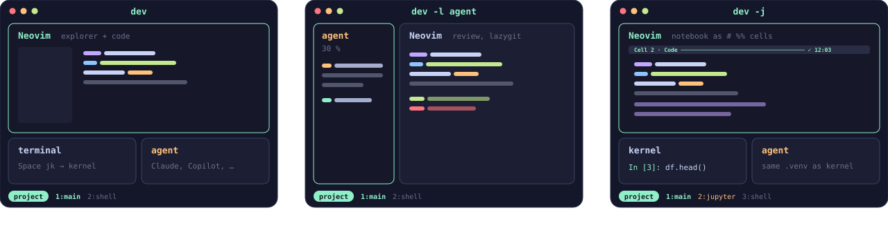

# Daily use

[← Back to the overview](../README.md)

Three small commands come with this setup. `dev` opens your workspace, `jlab` opens JupyterLab, and `samebench` takes care
of the setup itself. All three are plain shell scripts in [`bin/`](../bin), so you can read every line they run.

## Starting a workspace

```bash
dev                  # workspace for the current folder
dev ~/code/project   # workspace for another folder
```

Every workspace is a tmux session named after its folder. If it is already running, `dev` simply takes you back
into it, with the editor, the agent and any kernel exactly where you left them. That also holds when an SSH
connection drops in between.

<p align="center">
  
</p>

| Layout | Start it with | What you see |
|---|---|---|
| `code` | `dev` | Neovim on top, a terminal bottom left, the agent bottom right. This is the default everywhere |
| `agent` | `dev -l agent` | The agent on the left with 30 percent of the width, Neovim on the right for reviewing |
| `code` with Jupyter | `dev -j` | Like `code`, plus a JupyterLab window and a kernel from the project's `.venv` |

A second tmux window called `shell` is always there for anything else. Switch windows with <kbd>Ctrl</kbd>+<kbd>b</kbd>
and then the number. The first `dev -j` in a project asks before it installs anything, and the
[notebook guide](notebooks.md#a-typical-day-with-notebooks) explains each question.

When the folder has a `.venv`, it is active for the whole session. Neovim's language servers (ruff and ty), the
agent and the terminal all see the project's packages without you activating anything. The one exception is a
`.venv` that came with the repository itself. `dev` leaves it alone and tells you so.

## Managing sessions

| Command | What it does |
|---|---|
| `dev -s` | List the running sessions |
| `dev -k` | Stop the session of the current folder, including the agent, the kernel and JupyterLab |
| `dev -k ~/code/project` | Stop the session of another folder |
| `dev -r` | Stop and rebuild, for example `dev -r -j` to add Jupyter or `dev -r -l agent` for the other layout |
| <kbd>Ctrl</kbd>+<kbd>b</kbd> then <kbd>d</kbd> | Leave the session and let it keep running |

> [!CAUTION]
> `dev -k` doesn't ask. Save your work in Neovim first with `:wa`. When the last session is gone, the tmux server
> behind `dev` stops as well.

`dev` runs on its own tmux server (`tmux -L samebench`) with the configuration from this repository. Your own tmux, if you
have one, never sees these sessions, and plain `tmux ls` won't list them. Use `dev -s` instead.

## Opening JupyterLab

```bash
jlab
```

`jlab` finds the JupyterLab that belongs to the current folder and does two things. It prints the address with the
login token as a clickable link, and it opens your browser wherever that is possible.

| Where you are | What happens |
|---|---|
| macOS | The browser opens |
| WSL | Your Windows browser opens |
| Linux with a desktop | The browser opens |
| Linux over SSH | You get the link, <kbd>Ctrl</kbd>+click or <kbd>Cmd</kbd>+click opens it locally |

Your clipboard is never touched. Inside a session, <kbd>Ctrl</kbd>+<kbd>b</kbd> then <kbd>o</kbd> does the same as
typing `jlab`. For the SSH case, the [installation guide](installation.md#linux-vm-over-ssh) shows the port
forwarding and an optional PowerShell function that opens the browser without a click.

## The daily check

The first `dev` of the day spends about a second on two questions. Are there known vulnerabilities in the installed
versions, and is the repository on GitHub newer than your copy? If everything is fine you see a single line. When
something important comes up, `dev` asks you what to do before it opens the workspace. The details are in
[updates and security](updates-and-security.md).

## Where to look things up

Inside Neovim, <kbd>Space</kbd> <kbd>H</kbd> opens a short [cheat sheet](quickref.md). The
[full cheat sheet](cheatsheet.md) has every key for Neovim, tmux, lazygit and notebooks. When you press
<kbd>Space</kbd> and wait a moment, which-key shows all the options at that point.
