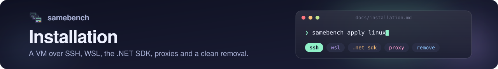

<div align="center">

<picture>
  <source media="(prefers-color-scheme: dark)" srcset="assets/head-installation-dark.svg">
  <source media="(prefers-color-scheme: light)" srcset="assets/head-installation-light.svg">
  
</picture>

<br>

**[VM over SSH](#linux-vm-over-ssh)** &nbsp;·&nbsp;
**[WSL](#wsl-on-windows)** &nbsp;·&nbsp;
**[.NET SDK](#the-net-sdk)** &nbsp;·&nbsp;
**[Existing setup](#machines-with-an-existing-setup)** &nbsp;·&nbsp;
**[Proxy](#behind-a-proxy)** &nbsp;·&nbsp;
**[Remove](#taking-it-all-away-again)**

[← Back to the overview](../README.md)

</div>

<br>

The three commands that set up a Mac, a Linux machine or WSL are in the [overview](../README.md#install). This page
covers what goes beyond them.

Every machine gets a **profile**, a small file that sets what differs from the built-in defaults. Two profiles
ship with the repository, and the [configuration guide](configuration.md#profiles) explains every setting.

| Profile | For |
|---|---|
| `mac` | A Mac with Apple silicon |
| `linux` | Ubuntu or Debian on x64 or arm64, which includes a VM over SSH and WSL |

Before anything is installed, `samebench` shows you a plan with every program, its version, the way it is verified and
the exact download URL. Nothing happens until you say yes. You can look at that plan on its own at any time. On a
machine that is not set up yet, call `samebench` by its path and name the profile.

```bash
samebench plan                         # on a machine that is set up
~/samebench/bin/samebench plan linux   # on a new machine
```

After your yes, `samebench apply` downloads the one program it fetches itself, the version manager mise. The
version and the SHA-256 sums for the supported platforms sit at the top of [`bin/samebench`](../bin/samebench).
When the download does not match, `samebench` stops and installs nothing. Everything else comes through mise and
the lockfiles. This mise is a copy of its own in `~/.local/share/samebench/bin` with folders of its own, and it is
not on your `PATH`. When you want to ask it something, type `samebench mise`, for example `samebench mise ls`. On
Linux, `samebench apply` also warns when `unattended-upgrades` is missing.

## Linux VM over SSH

On the VM itself you follow the [Linux steps](../README.md#install). Everything runs there, including Neovim, the
agent, `dev -j` and JupyterLab. On the computer you sit at, you only run `ssh`, for example from PowerShell in
Windows Terminal or from the macOS Terminal.

<p align="center">
  
</p>

To reach JupyterLab in your local browser, SSH forwards the ports, which is what VS Code does for you
automatically. Add this once to your SSH config. On Windows it lives in `C:\Users\<you>\.ssh\config`, on a Mac in
`~/.ssh/config`.

```ssh-config
Host my-vm
  HostName <ip-or-dns-name>
  User <user>
  IdentityFile ~/.ssh/id_ed25519_my_vm
  ForwardAgent no
  LocalForward 8888 127.0.0.1:8888
  LocalForward 8889 127.0.0.1:8889
  LocalForward 8890 127.0.0.1:8890
```

Three ports let you run up to three `dev -j` sessions at the same time. Each forward only listens on `127.0.0.1` of
your own computer, so other devices on your network can't reach JupyterLab, and the token protects it on top of
that. `ForwardAgent no` matters too, because otherwise the agent on the VM could use your local SSH keys.

After `ssh my-vm` and `dev -j`, type `jlab`. A program on the VM can't open the browser on your computer, and that
is intentional, so `jlab` prints a clickable link instead. <kbd>Ctrl</kbd>+click opens it in Windows Terminal,
<kbd>Cmd</kbd>+click on a Mac.

<details>
<summary><b>Optional: type <code>jlab</code> in PowerShell and the browser opens</b></summary>

<br>

Put this function into your PowerShell profile (`notepad $PROFILE`). It asks the VM for the address over your
normal SSH connection and opens it locally.

```powershell
function jlab([string]$Folder = "") {
  $url = ssh my-vm "~/samebench/bin/jlab --url $Folder"
  if ($url -match '^http://127\.0\.0\.1:(8888|8889|8890)/lab\?token=[0-9a-f]+$') { Start-Process $url }
  else { Write-Host "No JupyterLab found. Is dev -j running on the VM?" }
}
```

The function only ever opens `127.0.0.1` on one of the forwarded ports with a token in the expected format. Even a
manipulated answer from the VM could not send your browser anywhere else. With several `dev -j` sessions,
`jlab demo` picks the right one.

</details>

> [!NOTE]
> Reconnecting is painless. If the SSH connection drops, run `ssh my-vm` and `dev` again. The session, the kernel and
> the agent kept running on the VM the whole time.

If the VM runs in a cloud, open only port 22 in its firewall and ideally only for your own IP. Log in with keys only.
If the VM has a **cloud identity** attached, such as an instance role or a managed identity, any process on it, the
agent included, can request tokens for that cloud. Remove the identity or keep its rights minimal.

### A frontend development server on the VM

You start a development server yourself, in the terminal pane of its session on the VM, as the
[overview](../README.md#frontend-and-backend-side-by-side) shows. To open the application in your local browser, forward its port the same
way. Angular's server uses port 4200.

```ssh-config
Host my-vm
  LocalForward 4200 127.0.0.1:4200
```

Start the server with `ng serve --ssl` and open `https://localhost:4200` on the computer you sit at. The server
only listens on `127.0.0.1` of the VM, and the forward only on `127.0.0.1` of your own computer. Your browser
warns about the certificate the first time, because the development server signs its own. When the frontend
reaches its backend through the proxy configuration of the development server (`proxy.conf.json`), this one port
is enough. Otherwise add a `LocalForward` line for the backend's port as well.

A backend that you start with `dotnet run` in its own session works the same way. It prints the address it
listens on when it starts, and by default that is `localhost` only. Add a line with that port, for example
`LocalForward 5001 127.0.0.1:5001`, when you want to call the backend from your local browser or an API client.

## WSL on Windows

Follow the [Linux steps](../README.md#install) inside your WSL distribution and use Windows Terminal. Keep the
repository and your projects inside the Linux file system, for example in `~/projects`. Under `/mnt/c` everything
is slow, and file permissions and file watching don't behave properly.

`jlab` opens JupyterLab directly in your Windows browser, because WSL forwards `127.0.0.1` on its own. For the
`nerd` icons, install a Nerd Font on the Windows side and select it in Windows Terminal.

> [!WARNING]
> Inside WSL every Linux process, the agent included, can read your Windows drives under `/mnt/c` and start Windows
> programs such as `powershell.exe`. The agent's sandbox limits this, but the door is there. You can close it in
> `/etc/wsl.conf` with `[automount] enabled=false` and `[interop] enabled=false`. After that, `jlab` can no longer open
> the browser and shows the link instead. `samebench doctor` reminds you of this on WSL.

## The .NET SDK

The [`dotnet` module](configuration.md#the-dotnet-module) needs a .NET SDK, and the SDK comes from your system.
mise could install it as well, but it does so without verifying a checksum, so this setup leaves the SDK to the
package manager of the system. `DOTNET_SDK` names the versions you want, by default `"10.0 11.0"`. `samebench
apply` looks for them before it shows its plan, and a missing version never stops the setup. Without any SDK of
version 10 or newer the two .NET tools are left out, and C# stays at syntax highlighting until you install one
and run `samebench apply` again.

On a Mac, install the SDK with the signed installer package from Microsoft, which the
[install page for macOS](https://learn.microsoft.com/dotnet/core/install/macos) links. `samebench` downloads
nothing here. The installer puts .NET into `/usr/local/share/dotnet` and adds it to the `PATH` of new terminals,
so open a new terminal before you run `samebench apply` again. Several SDK versions can sit side by side.

On Ubuntu and Debian, `samebench apply` shows the command and asks, as it does for the other system packages. It
only offers that when your package sources have the package.

```text
 !! Missing .NET SDK 10.0. Your package sources offer dotnet-sdk-10.0 <version>.
Install it now with "sudo apt-get install -y dotnet-sdk-10.0"? [y/N]
```

Where a version comes from depends on the release. This is the state of November 2026.

| System | .NET 10 | .NET 11 |
|---|---|---|
| Ubuntu 24.04 and 26.04 | the Ubuntu archive | only the .NET backports PPA |
| Ubuntu 26.10 | the Ubuntu archive | the Ubuntu archive |
| Ubuntu 22.04 | only the .NET backports PPA | only the .NET backports PPA |
| Debian 12 and 13 | only Microsoft's package feed | only Microsoft's package feed |

The Ubuntu archive is the signed archive of the distribution, which your system trusts anyway. The backports PPA
(`ppa:dotnet/backports`) and Microsoft's feed (`packages.microsoft.com`) are separate package sources outside of
it. `samebench` never adds a package source. When a version only comes from one of them, it says so and goes on,
and you decide whether you add that source yourself. Stay with one source for .NET on a machine, because packages
from different sources get in each other's way.

Ubuntu builds its SDK from source in the first feature band of a version, for example `10.0.1xx`, while
Microsoft's installer brings a later band such as `10.0.4xx`. Both come with the same runtime. The difference
shows when a project pins the SDK in a `global.json`. A pin to a version of the 4xx band does not find Ubuntu's
SDK. A pin that both satisfy works everywhere, for example `10.0.100` together with
`"rollForward": "latestFeature"`.

## Machines with an existing setup

`samebench` never deletes or uninstalls anything it did not create, and it doesn't replace configuration files that
belong to someone else without keeping a copy.

| Already there | What happens |
|---|---|
| Your own `~/.config/nvim` | Stays as it is. This setup uses its own folder `~/.config/samebench-nvim` |
| Your own tmux and `tmux.conf` | Stay as they are. `dev` runs its own tmux server |
| `~/.config/uv/uv.toml` with your own uv settings | Stays unchanged |
| uv, Jupyter or Python from Homebrew, pip or apt | Stay installed, and `samebench plan` lists them |
| Node.js from nvm, Homebrew or apt | Stays installed, and samebench never updates or removes it. With the `web` module, `samebench plan` and `samebench doctor` name it with its version and path, and the daily check reports advisories for it as a note. With `NODE="system"` samebench uses it instead of a Node.js of its own, see [the web module](configuration.md#the-web-module) |
| `~/.npmrc` with your own npm settings, for example a company registry | Stays unchanged and is used. The language servers of the `web` module come through the registry it names |
| A .NET SDK that is already installed | Is used as it is. With the `dotnet` module, `samebench` reads `dotnet --list-sdks` and changes nothing |
| Global .NET tools in `~/.dotnet/tools` | Stay as they are. The `dotnet` module keeps its two tools in a folder of its own |
| Your NuGet configuration, for example a company feed | Stays unchanged and is used. The .NET tools of the `dotnet` module come through the feeds it names |
| A mise of your own, with `~/.config/mise` and `~/.local/share/mise` | Is never read and never changed. samebench installs its own copy with folders of its own, and `samebench plan` lists yours as untouched |
| `.zshrc`, `.bashrc`, global git config | Get one addition each, nothing is replaced. Only the startup file of your login shell is created when it is missing, and `samebench remove` deletes a file it created once nothing else is in it |

On a machine where other tools should behave exactly as before, set the activation to `dev`. Then the tools
from mise only appear inside `dev` sessions, and every other shell, VS Code Remote included, stays the way it was.
Machine specific settings go into `~/.config/samebench/local.sh`, which is not part of the repository.

```bash
# ~/.config/samebench/local.sh
ACTIVATE="dev"     # only inside dev sessions
JUPYTER="no"       # never install Jupyter on this machine
```

Details of a single machine, such as mirror URLs or host names, never belong in the repository. Keep them in
`local.sh` or in the machine's own configuration files.

An earlier version of samebench kept mise in `~/.local/bin` and shared `~/.config/mise` and `~/.local/share/mise`.
The next `samebench apply`, also the one at the end of `samebench sync`, finds that setup by its links in
`~/.config/mise` and shows the move in its plan. After your yes it moves the program, the tools and the state into
the new folders without downloading anything again, deletes the old download cache and removes the old links.
Running `dev` sessions lose their tools through the move, so rebuild each one with `dev -r`. If you had a mise of
your own, either put aside as `mise.backup-<date>` or somewhere else on your `PATH`, that mise and its folders stay
or come back, and the tools of samebench are installed again into its own folder.

## Behind a proxy

Nothing in this repository sets or changes proxy settings. curl, git, mise, uv, npm and dotnet all read the
standard variables `HTTPS_PROXY`, `HTTP_PROXY` and `NO_PROXY` from your environment. A machine that already
reaches the internet through a proxy therefore needs no extra step for `samebench` or the daily check.

A few things are worth knowing.

- A proxy that inspects TLS traffic presents its own certificates. curl, git and mise trust the system certificate
  store. uv brings its own list and only looks at the system store when you ask for it, with `system-certs = true`
  in `~/.config/uv/uv.toml` or `UV_SYSTEM_CERTS=1` in your environment. `samebench` never touches that file.
  Node and npm bring their own list as well. Name the certificate of your proxy with `cafile` in `~/.npmrc`,
  which `samebench` never touches either.
- Downloads are still compared with the checksums in the lockfiles, so a file that changes on the way is rejected.
- Requests to JupyterLab on `127.0.0.1` never go through a proxy. <kbd>Space</kbd> <kbd>j</kbd> <kbd>k</kbd> ignores
  the proxy variables on purpose, because the login token must not leave the machine.
- Everyone behind the same proxy shares one address towards GitHub, and GitHub limits anonymous API requests per
  address. If `samebench apply` stops with a rate limit message, wait an hour or set `MISE_GITHUB_TOKEN` to a token that
  has no permissions at all.

## Taking it all away again

```bash
samebench remove           # asks, then asks again about the programs, data and caches
samebench remove --all     # also deletes the programs, data and caches, local.sh and allowed_signers
```

This removes the line in your shell startup files, the additions to your global git config, the link
`~/.config/samebench-nvim` (a backup comes back), running `dev` sessions and the two files in the temporary folder
with which the `dotnet` module skips the update check of its server. Files and folders that only exist
because samebench created them, such as `~/.zshrc` or `~/.bashrc`, `~/.gitconfig` and the global git attributes
and ignore files, are recorded in `~/.config/samebench/created` and go as well when nothing else is in them. A
setup made by an earlier version has no such record, so `samebench remove` names the files that are empty
afterwards instead of deleting them. The list of project folders you trusted goes with the rest of
`~/.config/samebench`, so a later setup asks again.

Afterwards it asks separately whether the installed programs, their data and the caches should go too. mise and
all of its folders are among them, and so is the Node.js of samebench. `samebench remove` says so, lists the npm
packages you installed globally with that Node.js, and leaves another Node.js alone. Your `local.sh` and your
`allowed_signers` stay. `samebench remove -y` skips the first question and keeps the programs. With `--all` the
programs, data and caches go as well, and so do `local.sh` and `allowed_signers`, so nothing of samebench is left
outside the repository. `samebench remove -y --all` does that without any question.

Some things stay in every case, because other programs share them or they belong to your system. Python versions
installed by uv and its package cache live in `~/.local/share/uv` and `~/.cache/uv`, and links such as
`~/.local/bin/python3.12` point to them. They belong to uv. The same goes for the package cache of npm in `~/.npm`
and for the folders of Jupyter, `~/.jupyter`, `~/.ipython` and `~/Library/Jupyter` on macOS or
`~/.local/share/jupyter` on Linux, which a Jupyter of your own shares. With the `dotnet` module, the SDK stays
because it belongs to your system, and so do `~/.dotnet`, the package cache in `~/.nuget` and the folders in which
the .NET language servers keep their own logs and caches. On Linux the Ubuntu packages that were installed after
your yes stay as well. A few small caches can stay too, from tree-sitter, from ty and from the signature check in
mise. `samebench remove` names all of them when they exist.
