# Notebooks

[← Back to the overview](../README.md)

This setup lets you edit notebooks in Neovim and look at them in JupyterLab at the same time, with **one kernel**
behind both. Run a cell from the editor and the browser already knows the variable. The repository you work in,
for example one that somebody else maintains, is never changed by any of this.

## A typical day with notebooks

```bash
git clone <repository> ~/projects/demo
cd ~/projects/demo
dev -j
```

`dev -j` takes care of four things before your workspace opens.

1. **The Jupyter tool.** JupyterLab, the console and jupytext are installed once, the first time you use `dev -j`,
   and only after you confirm. The versions come from [`envs/jupyter/uv.lock`](../envs/jupyter/uv.lock) with
   hashes. This environment holds Jupyter itself and none of your project's packages.
2. **The project's packages.** If the repository has a `uv.lock`, `dev -j` first tells you what that lockfile
   would install. It shows how many packages there are, names every package that does not come from PyPI together
   with its source, and reminds you that building a package can run code from it. After your yes it runs
   `uv sync --frozen`. You get exactly the versions the authors locked, and the lockfile is never rewritten. Without
   a `uv.lock`, nothing is downloaded automatically and `dev -j` tells you which command to run after you had a
   look. If the project needs a Python version you don't have yet, `dev -j` asks whether uv should install it.
3. **The kernel.** For this session only, the kernel called `python3` runs with the Python of the project's
   `.venv`. Notebooks that ask for `python3`, which is nearly all of them, just work. If the project doesn't bring
   `ipykernel`, it is added for the kernel alone from a locked list with verified hashes, and the project stays
   untouched. A project without a `.venv` gets a kernel with the Python of the Jupyter tool, which only knows the
   basic Jupyter packages. The kernel talks over local sockets instead of TCP.
4. **JupyterLab.** It starts in the second tmux window and only listens on `127.0.0.1`, with a token and without
   the terminal feature in the browser.

The question in step 2 comes once for each version of a `uv.lock`. Your yes is remembered as the SHA-256 of that
file in `~/.local/share/samebench/approved-locks`, so the next `dev -j` starts without asking. A lockfile that changed,
for example after `git pull`, asks again, and deleting its line or the whole file takes the approval back. A no
stops `dev -j` before any package is installed, and plain `dev` never installs packages at all.

Once the session is up, <kbd>Space</kbd> <kbd>j</kbd> <kbd>k</kbd> attaches the terminal below Neovim to the
notebook's kernel. From then on that console and JupyterLab in the browser are two views of the same kernel.

<p align="center">
  
</p>

## Working in Neovim

Open a notebook as usual with <kbd>Space</kbd> <kbd>e</kbd> or <kbd>Space</kbd> <kbd>Space</kbd>. You see Python
cells marked with `# %%` and the task texts as `# %% [markdown]`. Language servers, search and the agent work the
same as with any other Python file.

| Keys | Action |
|---|---|
| <kbd>Space</kbd> <kbd>j</kbd> <kbd>k</kbd> | Turn the terminal below into a console on this notebook's kernel |
| <kbd>Space</kbd> <kbd>j</kbd> <kbd>j</kbd> | Run the cell, or the selection in visual mode |
| <kbd>Space</kbd> <kbd>j</kbd> <kbd>n</kbd> | Run the cell and move to the next one |
| <kbd>Space</kbd> <kbd>j</kbd> <kbd>a</kbd> | Run every cell up to here |
| <kbd>Space</kbd> <kbd>j</kbd> <kbd>l</kbd> | Run the current line |
| <kbd>]</kbd> <kbd>j</kbd> · <kbd>[</kbd> <kbd>j</kbd> | Next cell · previous cell |
| <kbd>Space</kbd> <kbd>j</kbd> <kbd>c</kbd> · <kbd>Space</kbd> <kbd>j</kbd> <kbd>m</kbd> | New code cell · new markdown cell below |
| <kbd>Space</kbd> <kbd>j</kbd> <kbd>d</kbd> | Compare the notebook with the last commit |
| `:w` | Save back into the `.ipynb`, outputs are kept |

Each cell gets a bar like `Cell 3 · Code ──── ✓ 12:03` with the time it last ran, and markdown cells are shown in
violet italics. That is purely visual, the file itself doesn't change.

## Working in the browser

`jlab` opens JupyterLab with the same kernel. Two things are worth knowing.

Code you change in Neovim reaches the browser after **File → Reload Notebook from Disk**. Output of cells you run
from Neovim shows up in the console, not in the notebook. When you want plots or tables inside the notebook, run
that cell in the browser.

> [!WARNING]
> Don't type in the browser without reloading first. Otherwise the browser saves its older copy over the changes
> you made in Neovim.

Before you share a notebook, reload it from disk in the browser, choose **Restart Kernel and Run All**, save and
commit.

In **VS Code** you can use the same kernel. Choose *Select Kernel → Existing Jupyter Server* and paste the address
from `jlab --url`.

## How it works underneath

Neovim edits a hidden shadow file next to the notebook, for example `.analysis.nb.py` for `analysis.ipynb`. When you save,
it is written back into the notebook and the existing outputs survive. The conversion uses the jupytext library
without reading any configuration from the repository. Your global git ignore list
hides the shadow files, which means the repository only ever sees the notebook itself change. If the agent
edits the `.ipynb`, Neovim reloads it on its own, and if you have unsaved changes, it warns you instead.

Notebook diffs in `git diff` and lazygit show the code without outputs, which makes them easy to review. Code is
only ever sent to a running Python or Jupyter console and never into a plain shell.

## Python and packages

| What | Comes from | Lives in |
|---|---|---|
| Python | uv, only after you confirm | `~/.local/share/uv/python` |
| Project packages such as pandas | `uv sync` in the project | the project's `.venv` |
| The Jupyter tool | `envs/jupyter/uv.lock`, on the first `dev -j` | `~/.local/share/samebench/jupyter-venv` |
| uv, ruff and ty | mise with checksums and GitHub attestations | `~/.local/share/mise` |

No Python package is installed globally. Be careful with `uv pip install jupyter` inside a project. It installs
without an entry in `pyproject.toml` or `uv.lock`, so there are no hashes, and the next `uv sync` removes it again.
Use `dev -j` for Jupyter instead.

> [!NOTE]
> The seven day minimum age for packages is not set globally on purpose. A global setting makes `uv sync` rewrite
> the `uv.lock` of repositories that are not yours. For your own projects, add it to their `pyproject.toml`.
>
> ```toml
> [tool.uv]
> exclude-newer = "7 days"
> ```
