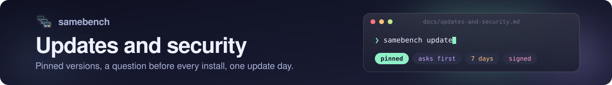

<div align="center">

<picture>
  <source media="(prefers-color-scheme: dark)" srcset="assets/head-security-dark.svg">
  <source media="(prefers-color-scheme: light)" srcset="assets/head-security-light.svg">
  
</picture>

<br>

**[What is pinned](#what-is-pinned-where)** &nbsp;·&nbsp;
**[What asks first](#what-asks-first)** &nbsp;·&nbsp;
**[Someone else's repository](#opening-someone-elses-repository)** &nbsp;·&nbsp;
**[Update day](#update-day-once-a-month)** &nbsp;·&nbsp;
**[Daily check](#the-daily-check)** &nbsp;·&nbsp;
**[Sync](#syncing)** &nbsp;·&nbsp;
**[Signed commits](#signed-commits)** &nbsp;·&nbsp;
**[The agent](#the-coding-agent)**

[← Back to the overview](../README.md)

</div>

<br>

The idea behind this setup is simple. **The repository is the list of approved versions.** No machine picks
versions on its own. New versions enter the repository in one commit on one machine, and every other machine
installs exactly that, after it has asked you.

<p align="center">
  
</p>

## What is pinned where

| Layer | What | Pinned by |
|---|---|---|
| System | git, C compiler | Apple or Ubuntu, signed |
| mise | the version manager that installs the tools | Version and SHA-256 at the top of `bin/samebench` |
| Tools | neovim, tmux, lazygit, ripgrep, fd, tree-sitter, uv, ruff, ty | `config/mise-global/mise.lock`, checksums per platform |
| Neovim plugins | LazyVim and its plugins | `config/nvim/lazy-lock.json`, exact commits |
| Treesitter parsers | grammar sources, compiled on your machine | revisions fixed by the locked nvim-treesitter commit, fetched from GitHub without a separate checksum |
| Jupyter tool | jupyterlab, jupyter-console, jupytext, ipykernel | `envs/jupyter/uv.lock`, hashes |
| Project packages | whatever the project you open asks for | the project's own `uv.lock`, installed exactly as locked |
| Python | CPython builds | checksums inside uv |
| Node.js, with the `web` module | the release from nodejs.org | `config/mise-global/mise.lock`, checksums per platform, which mise takes from the signed checksum file of the release |
| Web language servers, with the `web` module | vtsls, the Angular language server, TypeScript and the servers for HTML, CSS, JSON and ESLint | `envs/web/package-lock.json`, integrity hashes |
| npm packages of a frontend project | whatever its `package.json` asks for | the project's own lockfile. You install them yourself with `npm ci`, this setup never does |
| .NET SDK, with the `dotnet` module | the SDK versions named in `DOTNET_SDK` | your system. On Ubuntu that is the signed archive of the distribution, on a Mac the signed installer from Microsoft |
| .NET tools, with the `dotnet` module | EasyDotnet, the server behind easy-dotnet.nvim, and `roslyn-language-server` | `envs/dotnet/tools.txt`, exact versions. NuGet checks package signatures where it can, see below |
| NuGet packages of a .NET project | whatever its project files ask for | the project itself. You restore them yourself with `dotnet restore`, this setup never does |

mise is the one program `samebench` downloads itself. It compares the download with the SHA-256 for your platform and
stops without installing anything when the two differ.

The two .NET tools are the one list without a checksum of its own. `envs/dotnet/tools.txt` pins exact versions,
and `dotnet tool` fetches them from the feed in your NuGet configuration. NuGet verifies the signatures of
packages from nuget.org, by default on Linux, and on macOS because `samebench` turns the check on for this one
install. A company feed may not declare its packages as signed, so take the check as a safeguard for the public
feed and not as a guarantee for every source.

When a lockfile is missing or empty, `samebench apply` stops as well, because installing without it would mean
taking whatever version is newest. Only the machine with `UPDATER="yes"` goes on and creates a new one.

The plugin list gets the same care. `samebench apply` stops when a plugin is not at its locked commit, and
[how it works](architecture.md#what-samebench-apply-does) explains how it keeps lazy.nvim from changing the list.

Some things are switched off on purpose.

- **Mason** stays off, so tools and language servers only come from the lists above.
- **The prebuilt completion binary** of blink.cmp is replaced by its pure Lua version.
- **lazy.nvim** doesn't look for updates in the background, doesn't use luarocks and ignores a `.lazy.lua` in
  project folders.
- **mise** runs in paranoid mode, without asdf or vfox plugins and without installing anything on its own. It
  doesn't look for newer versions of itself either, so it only changes through the version pinned in `bin/samebench`.
- **tmux plugins and `curl | sh` installers** are not used anywhere.
- **Setting the clipboard from a tmux pane** is blocked, for programs and for text that is merely printed there.
  A hostile file shown with `cat`, or output from a remote machine, can't fill your clipboard. Copy mode and
  copying from Neovim work as before, also over SSH, where `"+y` reaches the clipboard of the machine you sit at.
  Pasting from `"+` over SSH depends on your terminal, which may ask first or refuse.
- **uv** never downloads Python silently.
- **npm** installs the web language servers without running any install script and takes no package from a git
  repository. It sends no audit request and doesn't look for a newer npm while it does that.
- **Automatic type acquisition** of the TypeScript server is off. It would install type packages from the npm
  registry in the background.
- **The self-install of easy-dotnet.nvim and its server** never runs. The plugin would install the newest
  EasyDotnet with `dotnet tool install -g` when it is missing, and EasyDotnet would install the newest
  `roslyn-language-server` the same way. Both tools are pinned and installed by `samebench apply` instead, and
  the plugin does not load while one of them is missing.
- **The update check of the EasyDotnet server** is skipped. It would ask api.nuget.org about newer versions on
  every start, whatever feed you configured. The server has no option for that, so Neovim sets the time of its
  last check far into the future. That is a best effort with the pinned version. On Linux Neovim only does it
  when the folder for that file belongs to you and nobody else can write to it.
- **JupyterLab** only listens on `127.0.0.1`, needs a token, has no terminal in the browser, and the kernel talks
  over local sockets. Its extension manager can't install anything, and it doesn't fetch news or look for updates.
- **Format on save** is off, so you never reformat someone else's code by accident.

## What asks first

Nothing from the table above arrives on its own. Each install waits for a yes.

| Before this is installed | The question comes from |
|---|---|
| mise, the tools, the plugins, the web language servers and the .NET tools | `samebench apply`, after it has shown the whole plan |
| Missing system packages on Linux | `samebench apply`, with the exact `apt-get` command |
| A .NET SDK on Linux, when your package sources offer it | `samebench apply`, with the exact `apt-get` command. On a Mac `samebench` only names Microsoft's installer |
| The Jupyter tool | the first `dev -j`, or `samebench jupyter` |
| A project's packages | `dev -j`, once for each version of the project's `uv.lock` |
| A Python version | `dev -j`, `samebench jupyter` or `samebench update`, before uv downloads it |
| A fix for a security advisory | `dev` or `samebench check` |
| New commits for this repository | `samebench sync` |

One more question is not about an install. With the `web` or the `dotnet` module, `dev` asks once per project
folder before the language servers and formatters in Neovim may load code from that folder. The next section says
what a yes allows.

## Opening someone else's repository

A cloned repository should not be able to run anything just because you look at it. These rules hold until you
run its code yourself, for example a notebook cell, or tell `dev` that you trust the folder.

- A `.venv` that the repository ships, meaning git tracks files in it, is never activated and never becomes a kernel.
- A kernel starts without the notebook's folder on its import path, so a file in the repository can't take the
  place of the kernel's own start module. The folder becomes importable once the kernel is up.
- Notebooks are converted for Neovim and for `git diff` without reading any configuration from the repository. The
  `jupytext` command would run a `.jupytext.py` it finds next to a notebook, so the setup calls the library instead.
- Neovim ignores modelines and project plugin files, and folder names are escaped before tmux hands them to a shell.
- Project packages are only installed by `dev -j`, exactly as the project's `uv.lock` says, and only after you
  have approved that lockfile. `dev -j` shows how many packages it holds and names every package that does not
  come from PyPI, with the index, git repository, URL or path it comes from. Building a package can run code from
  it, so say yes only in repositories you trust that far. A lockfile that changes asks again, and plain `dev`
  never installs packages.
- With the `web` module, every language server starts from samebench's own folder and never from the project's
  `node_modules`. Until you trust a folder, the servers run in a restricted mode in which only code from that
  folder runs. The project's own TypeScript, its Angular language service and the plugins its `tsconfig.json`
  names are not loaded, and ESLint and prettier stay off, because both load JavaScript from the project. The
  JSON server downloads no schema that a file names by URL.
  [The web module](configuration.md#the-web-module) says what that means while you work.
- With the `dotnet` module, the C# language server has no restricted mode. To understand a project it evaluates
  the MSBuild files and runs design-time builds, and those run build targets from the folder, for example from a
  `Directory.Build.targets`. So until you trust a folder, the plugin does not load at all. No .NET process starts,
  and C# files get syntax highlighting only.
- `dev` asks once per project folder whether you trust it, when it builds a session there. A yes is a real
  decision. From then on code from the repository runs with your permissions as soon as you open a file. In a
  frontend that is everything the restricted mode keeps out. In a .NET solution it is the build targets, within
  seconds of opening a C# file, and the test assemblies, which the discovery of the tests loads. Say yes for your own
  projects and for repositories in which you would also run `npm ci` or `dotnet build`. A no changes nothing, and
  the session opens all the same.
  [Trusted project folders](configuration.md#trusted-project-folders) shows the question, how far a yes reaches,
  where the answers are kept and how to take one back.
- A `mise.toml` or `.nvmrc` in a project can't bring in another Node version. mise ignores `.nvmrc`. It refuses a
  `mise.toml` from a project folder with an error until you approve that file with `mise trust`, and it only
  installs what the lockfile of this repository names. A project file that asks for another Node version gets
  none, also after `mise trust`, so `node` is then missing in that folder instead of replaced.

Commands you type are a different matter. `npm ci`, `npm install`, `ng serve`, `dotnet build` and `dotnet run`
run the project's code and the install scripts or build targets of its packages, like any other program you
start in a terminal.

Two things the .NET tools send on their own are worth knowing, because `samebench` leaves both alone. The C#
language server sends usage data to Microsoft, and in tests with the pinned version neither the opt-out variable
of the .NET CLI nor the server's own telemetry switch stopped that. Blocking it would mean changing the proxy
settings of the server, which this setup does not do. The `dotnet` command sends usage data as well unless you
set `DOTNET_CLI_TELEMETRY_OPTOUT=1` yourself, for example in your shell profile. `samebench` does not set it for
you, because that choice may be yours or your company's to make.

## Update day, once a month

Update day happens on one machine, the one with `UPDATER="yes"`.

```bash
samebench update
```

This brings in new versions of the tools, the Neovim plugins, the Jupyter packages and the web language servers,
and it only takes versions that are at least seven days old. Most hijacked releases are discovered within a few
days, and the delay keeps you out of that window.

| Step | What happens |
|---|---|
| Tools | mise locks new versions for macOS and Linux and checks signatures and provenance |
| Plugins | Each plugin is locked to the newest commit on its branch that is at least seven days old, then lazy.nvim checks out exactly the lockfile |
| Jupyter tool | `uv lock --upgrade` with the seven day rule |
| Python | `uv python upgrade` for the versions uv installed, which brings security patches within a version |
| Web language servers | `npm update` writes only the lockfile and takes versions published at least seven days ago. This step runs on a machine with the `web` module |
| .NET tools | Nothing changes. The step shows, for each tool in `envs/dotnet/tools.txt`, the pinned version and the newest one on your feed with its publish date. This step runs on a machine with the `dotnet` module |

Plugins have no registry that records a release date, so for them the rule works on the date of a commit. Its
author sets that date, which makes it a weaker signal than the release date of a package registry. A plugin never
moves backwards from a commit that is old enough, and any error while fetching stops the update and leaves
`lazy-lock.json` alone. [The seven day rule](architecture.md#the-seven-day-rule) explains how the commit of each
plugin is chosen.

Look at the diff, try it for a minute with `dev`, then commit and push. In Neovim, `:Lazy` → *Log* shows the new
commits per plugin. Every other machine follows with `samebench sync`. Major versions such as Neovim 0.12 to 0.13 are
pinned in `modules/*/tools.toml` and only change when you decide so. The same holds for Node, which stays on one
major version, and for the language servers, which move within the ranges in `envs/web/package.json`.

Node publishes security releases several times a year. Within the pinned major version they arrive by
themselves, on update day once the release is seven days old, or earlier through the daily check described
below, which offers the fixed version as soon as an advisory for your version is rated high or critical.

The .NET tools are raised by hand. Their step on update day shows what is new, and you put the version you want
into `envs/dotnet/tools.txt`. No program enforces the seven day rule here, so pick a version that is old enough
yourself, which is what the publish date in the overview is for. EasyDotnet is the server of easy-dotnet.nvim,
and the two only work together within one major version. The plugin moves with the other plugins on update day,
so when a new major version arrives, raise EasyDotnet in the same commit. `samebench doctor` warns when the two
differ. After changing the file, `samebench apply` installs the new versions.

To update **mise itself**, change its version and the checksums at the top of `bin/samebench`. The checksums come
from the `SHA256SUMS` file of the release, and a version that is at least seven days old is the right choice here
too. Commit and push. Every machine gets the new mise with its next `samebench sync`, because sync ends in `samebench apply`.
`samebench doctor` warns when the installed mise differs from the pinned version.

## The daily check

The first `dev` of the day asks [OSV.dev](https://osv.dev), the open vulnerability database that also contains
the GitHub security advisories and PyPI, about the versions you actually have installed. Only package names and
versions are sent. The answer is cached for a day, so every later `dev` starts instantly.

The check covers uv, ruff, ty, lazygit, ripgrep, fd and tree-sitter, every package of the Jupyter tool, and the
`uv.lock` of the project you open. From a project, only packages that come from PyPI are sent. Its own name and
packages from other indexes stay on your machine. For the project you only get a note, because the project is
never changed. If OSV.dev answers only in part, the check counts as not done and runs again next time.
Neovim, tmux and Python itself have no matching package in OSV, and the monthly update day covers them.

With the `web` module the check also covers Node and every installed package of the web language servers. OSV
has no package for Node itself, so the check uses the entries of the Bitnami vulnerability database, which list
the advisories of the Node project by Node version. For the language servers you only get a note. They have no
targeted fix, and the next update day brings their new versions. The npm packages of a project you open are not
checked. Run `npm audit` in the project for that.

The two .NET tools of the `dotnet` module are not part of the check. OSV would only see their two package names
and not what they bundle, so the update day covers them. The NuGet packages of a project you open are not checked
either. `dotnet restore` reports known vulnerabilities in them by itself.

When a vulnerability is rated **high or critical**, `dev` asks you before the workspace opens.

```text
 !! lazygit 0.66.3: high or critical security advisory (GHSA-…), fixed in 0.66.4
    Lift lazygit to 0.66.4 now (exception from the 7 day rule)? [y/N]
```

Saying yes lifts only that package, and only to the version the advisory names as fixed, not to the newest one.
Checksums and hashes stay mandatory. A fixed version outside the major version pinned in `modules/*/tools.toml`
is not offered. `dev` names it and says that the pin has to change, because changing a major version stays your
decision. Less severe findings appear as a single line,
and `samebench check` shows the details. To turn the check off on a machine, set `CHECK="off"`.

> [!NOTE]
> The exception from the seven day rule needs an entry in an independent advisory database. A release note that
> calls itself a security fix is not enough, since that is exactly how some attacks disguise themselves.

## Who maintains the lockfiles

One machine of your choice gets `UPDATER="yes"` in `~/.config/samebench/local.sh`. There `samebench fix` offers to
commit and push right after the fix, and all other machines pick it up with `samebench sync`.

On every other machine a fix is applied **locally only**, as an emergency measure. `samebench doctor` shows that the
machine deviates. As soon as the repository contains the fix, `samebench sync` switches back to the repository's version.
Until then the local fix stays active. Should it no longer fit the lockfiles of a new state, `samebench sync` drops
it, says so and stops, and the next check offers the fix again.

<p align="center">
  
</p>

## Syncing

```bash
samebench sync
```

`samebench sync` shows the new commits and the changed files and asks before it takes them. Then the freshly fetched
`samebench apply` runs and installs exactly what the lockfiles say, a newly pinned mise included.

## Signed commits

Every machine trusts this repository. Whoever manages to push a commit to it reaches all of them with the next
`samebench sync`. Signing your commits with your SSH key closes that door.

Turn signing on where you commit from, and only for this repository.

```bash
git -C ~/Development/samebench config gpg.format ssh
git -C ~/Development/samebench config user.signingkey ~/.ssh/id_ed25519.pub
git -C ~/Development/samebench config commit.gpgsign true
```

The list of trusted keys belongs on **every** machine. It lives outside the repository on purpose, since an
attacker could otherwise change the list along with the code.

```bash
echo "you@example.com $(cat ~/.ssh/id_ed25519.pub)" > ~/.config/samebench/allowed_signers
```

From then on `samebench sync` only takes commits that carry your signature and stops with a clear message otherwise.
On GitHub, turn on two factor authentication or a passkey, protect the main branch against force pushes, and never
merge pull requests from strangers into it.

## The coding agent

The agent runs commands with your permissions, which makes it the biggest risk in any setup like this one.

- Keep its sandbox on and don't use bypass modes.
- Never forward your SSH agent to a VM. `samebench doctor` warns when it notices forwarding.
- Give a VM git access only to the repositories it needs, for example with a deploy key for a single repository.
- On a cloud VM, check whether it has an identity attached, such as an instance role or a managed identity. Any
  process on it, the agent included, can request tokens.
- On WSL, remember that Linux processes can reach your Windows drives. The
  [installation guide](installation.md#wsl-on-windows) shows how to limit that.

To report a security problem in this repository, see [SECURITY.md](../SECURITY.md).
