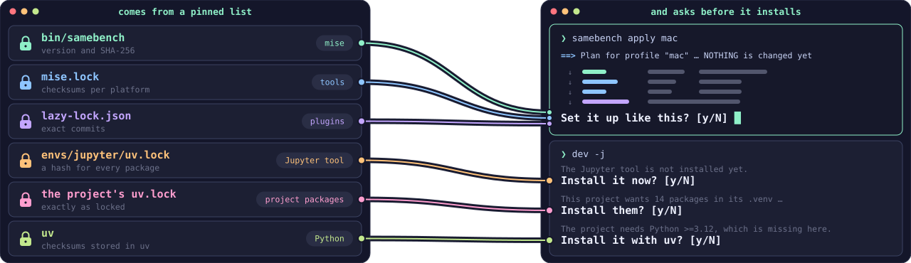
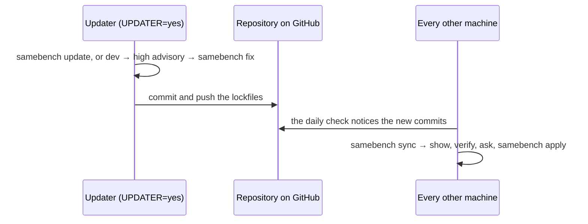

# Updates and security

[← Back to the overview](../README.md)

The idea behind this setup is simple. **The repository is the list of approved versions.** No machine picks
versions on its own. New versions enter the repository in one commit on one machine, and every other machine
installs exactly that, after it has asked you.

<p align="center">
  
</p>

## What is pinned where

| Layer | What | Pinned by |
|---|---|---|
| System | git, C compiler | Apple or Ubuntu, signed |
| mise | the version manager that installs the tools | Version and SHA-256 at the top of `bin/samebench` |
| Tools | neovim, tmux, lazygit, ripgrep, fd, tree-sitter, uv, ruff, ty | `config/mise-global/mise.lock`, checksums per platform |
| Neovim plugins | LazyVim and its plugins | `config/nvim/lazy-lock.json`, exact commits |
| Treesitter parsers | grammar sources, compiled on your machine | revisions fixed by the locked nvim-treesitter commit, fetched from GitHub without a separate checksum |
| Jupyter tool | jupyterlab, jupyter-console, jupytext, ipykernel | `envs/jupyter/uv.lock`, hashes |
| Project packages | whatever the project you open asks for | the project's own `uv.lock`, installed exactly as locked |
| Python | CPython builds | checksums inside uv |

mise is the one program `samebench` downloads itself. It compares the download with the SHA-256 for your platform and
stops without installing anything when the two differ.

When a lockfile is missing or empty, `samebench apply` stops as well, because installing without it would mean
taking whatever version is newest. Only the machine with `UPDATER="yes"` goes on and creates a new one.

The plugin list gets the same care. On a new machine LazyVim is fetched at its locked commit before lazy.nvim
starts, so that one round installs every plugin at its locked commit. lazy.nvim also rewrites `lazy-lock.json`
whenever it installs something, so `samebench apply` puts the pinned list back if that changed it and stops when a
plugin is not at its locked commit.

Some things are switched off on purpose.

- **Mason** stays off, so tools only come from mise.
- **The prebuilt completion binary** of blink.cmp is replaced by its pure Lua version.
- **lazy.nvim** doesn't look for updates in the background, doesn't use luarocks and ignores a `.lazy.lua` in
  project folders.
- **mise** runs in paranoid mode, without asdf or vfox plugins and without installing anything on its own. It
  doesn't look for newer versions of itself either, so it only changes through the version pinned in `bin/samebench`.
- **tmux plugins and `curl | sh` installers** are not used anywhere.
- **Setting the clipboard from a tmux pane** is blocked, for programs and for text that is merely printed there.
  A hostile file shown with `cat`, or output from a remote machine, can't fill your clipboard. tmux itself still
  can, so copy mode works as before, and so does copying from Neovim. Over SSH, `"+y` goes through tmux to the
  clipboard of the machine you sit at. Pasting from `"+` over SSH asks your terminal for its clipboard, which
  some terminals confirm or refuse, and the terminal's own paste key is unaffected.
- **uv** never downloads Python silently.
- **JupyterLab** only listens on `127.0.0.1`, needs a token, has no terminal in the browser, and the kernel talks
  over local sockets. Its extension manager can't install anything, and it doesn't fetch news or look for updates.
- **Format on save** is off, so you never reformat someone else's code by accident.

## What asks first

Nothing from the table above arrives on its own. Each install waits for a yes.

| Before this is installed | The question comes from |
|---|---|
| mise, the tools and the plugins | `samebench apply`, after it has shown the whole plan |
| Missing system packages on Linux | `samebench apply`, with the exact `apt-get` command |
| The Jupyter tool | the first `dev -j`, or `samebench jupyter` |
| A project's packages | `dev -j`, once for each version of the project's `uv.lock` |
| A Python version | `dev -j`, `samebench jupyter` or `samebench update`, before uv downloads it |
| A fix for a security advisory | `dev` or `samebench check` |
| New commits for this repository | `samebench sync` |

## Opening someone else's repository

A cloned repository should not be able to run anything just because you look at it. These rules hold until you
run its code yourself, for example a notebook cell.

- A `.venv` that the repository ships, meaning git tracks files in it, is never activated and never becomes a kernel.
- A kernel starts without the notebook's folder on its import path, so a file in the repository can't take the
  place of the kernel's own start module. The folder becomes importable once the kernel is up.
- Notebooks are converted for Neovim and for `git diff` without reading any configuration from the repository. The
  `jupytext` command would run a `.jupytext.py` it finds next to a notebook, so the setup calls the library instead.
- Neovim ignores modelines and project plugin files, and folder names are escaped before tmux hands them to a shell.
- Project packages are only installed by `dev -j`, exactly as the project's `uv.lock` says, and only after you
  have approved that lockfile. `dev -j` shows how many packages it holds and names every package that does not
  come from PyPI, with the index, git repository, URL or path it comes from. Building a package can run code from
  it, so say yes only in repositories you trust that far. A lockfile that changes asks again, and plain `dev`
  never installs packages.

## Update day, once a month

Update day happens on one machine, the one with `UPDATER="yes"`.

```bash
samebench update
```

This brings in new versions of the tools, the Neovim plugins and the Jupyter packages, and it only takes versions
that are at least seven days old. Most hijacked releases are discovered within a few days, and the delay keeps
you out of that window.

| Step | What happens |
|---|---|
| Tools | mise locks new versions for macOS and Linux and checks signatures and provenance |
| Plugins | Each plugin is locked to the newest commit on its branch that is at least seven days old, then lazy.nvim checks out exactly the lockfile |
| Jupyter tool | `uv lock --upgrade` with the seven day rule |
| Python | `uv python upgrade` for the versions uv installed, which brings security patches within a version |

Plugins have no registry that records a release date, so for them the rule works on commits. lazy.nvim, LazyVim
and blink.cmp follow release tags, and they move to a new release only once its commit is seven days old. A
plugin never moves backwards from a commit that is old enough. A commit in the lockfile that is itself younger
than seven days did not come through this rule, for example because a new LazyVim version brought a plugin along
and lazy.nvim installed its newest commit. Such a plugin moves back to the newest commit that is seven days old.
When it has none yet, it stays where it is and the update says so.

Two limits are worth knowing. The age is the date in the commit, which its author sets, so it is a weaker signal
than the release date a package registry records. And a fetch error, a broken plugin folder or a missing branch
stops the update and leaves `lazy-lock.json` alone.

Look at the diff, try it for a minute with `dev`, then commit and push. In Neovim, `:Lazy` → *Log* shows the new
commits per plugin. Every other machine follows with `samebench sync`. Major versions such as Neovim 0.12 to 0.13 are
pinned in `modules/*/tools.toml` and only change when you decide so.

To update **mise itself**, change its version and the checksums at the top of `bin/samebench`. The checksums come
from the `SHA256SUMS` file of the release, and a version that is at least seven days old is the right choice here
too. Commit and push. Every machine gets the new mise with its next `samebench sync`, because sync ends in `samebench apply`.
`samebench doctor` warns when the installed mise differs from the pinned version.

## The daily check

The first `dev` of the day asks [OSV.dev](https://osv.dev), the open vulnerability database that also contains
the GitHub security advisories and PyPI, about the versions you actually have installed. Only package names and
versions are sent. The answer is cached for a day, so every later `dev` starts instantly.

The check covers uv, ruff, ty, lazygit, ripgrep, fd and tree-sitter, every package of the Jupyter tool, and the
`uv.lock` of the project you open. From a project, only packages that come from PyPI are sent. Its own name and
packages from other indexes stay on your machine. For the project you only get a note, because the project is
never changed. If OSV.dev answers only in part, the check counts as not done and runs again next time.
Neovim, tmux and Python itself have no matching package in OSV, and the monthly update day covers them.

When a vulnerability is rated **high or critical**, `dev` asks you before the workspace opens.

```text
 !! lazygit 0.66.3: high or critical security advisory (GHSA-…), fixed in 0.66.4
    Lift lazygit to 0.66.4 now (exception from the 7 day rule)? [y/N]
```

Saying yes lifts only that package, and only to the version the advisory names as fixed, not to the newest one.
Checksums and hashes stay mandatory. Less severe findings appear as a single line, and `samebench check` shows the
details. To turn the check off on a machine, set `CHECK="off"`.

> [!NOTE]
> The exception from the seven day rule needs an entry in an independent advisory database. A release note that
> calls itself a security fix is not enough, since that is exactly how some attacks disguise themselves.

## Who maintains the lockfiles

One machine of your choice gets `UPDATER="yes"` in `~/.config/samebench/local.sh`. There `samebench fix` offers to
commit and push right after the fix, and all other machines pick it up with `samebench sync`.

On every other machine a fix is applied **locally only**, as an emergency measure. `samebench doctor` shows that the
machine deviates. As soon as the repository contains the fix, `samebench sync` switches back to the repository's version.
Until then the local fix stays active.



## Syncing

```bash
samebench sync
```

`samebench sync` shows the new commits and the changed files and asks before it takes them. Then the freshly fetched
`samebench apply` runs and installs exactly what the lockfiles say, a newly pinned mise included.

## Signed commits

Every machine trusts this repository. Whoever manages to push a commit to it reaches all of them with the next
`samebench sync`. Signing your commits with your SSH key closes that door.

Turn signing on where you commit from, and only for this repository.

```bash
git -C ~/Development/samebench config gpg.format ssh
git -C ~/Development/samebench config user.signingkey ~/.ssh/id_ed25519.pub
git -C ~/Development/samebench config commit.gpgsign true
```

The list of trusted keys belongs on **every** machine. It lives outside the repository on purpose, since an
attacker could otherwise change the list along with the code.

```bash
echo "you@example.com $(cat ~/.ssh/id_ed25519.pub)" > ~/.config/samebench/allowed_signers
```

From then on `samebench sync` only takes commits that carry your signature and stops with a clear message otherwise.
On GitHub, turn on two factor authentication or a passkey, protect the main branch against force pushes, and never
merge pull requests from strangers into it.

## The coding agent

The agent runs commands with your permissions, which makes it the biggest risk in any setup like this one.

- Keep its sandbox on and don't use bypass modes.
- Never forward your SSH agent to a VM. `samebench doctor` warns when it notices forwarding.
- Give a VM git access only to the repositories it needs, for example with a deploy key for a single repository.
- On a cloud VM, check whether it has an identity attached, such as an instance role or a managed identity. Any
  process on it, the agent included, can request tokens.
- On WSL, remember that Linux processes can reach your Windows drives. The
  [installation guide](installation.md#wsl-on-windows) shows how to limit that.

To report a security problem in this repository, see [SECURITY.md](../SECURITY.md).
